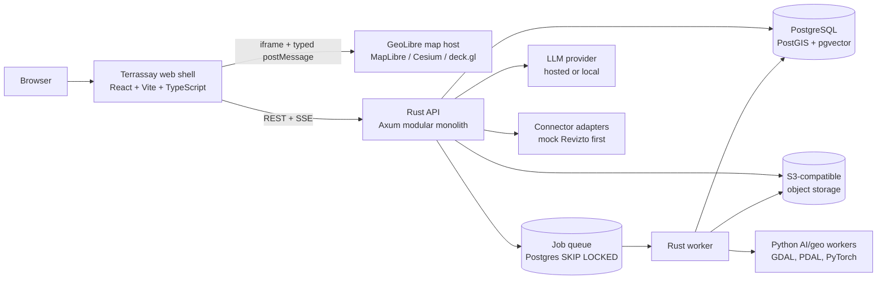

# Terrassay

**Physical asset intelligence, grounded.**

Terrassay connects BIM coordination data to geographic context. It is a self-hostable workspace where a construction team can locate a project on a map, overlay site and environmental data, ask spatial questions, and get answers grounded in the project record.

> **Status: planning + bootstrap — v0.1, November 2026.**
> Built by a solo maintainer working with AI agents. Open source from the start, with synthetic data and no paid tier.
> No application code exists yet; this repository contains the build plan, governance, and architecture decision records.
> The first milestone is a local, reproducible demo. There is no fixed deadline.

---

## Why this exists

BIM tools answer *what* is being built. GIS tools answer *where*. Construction teams still bridge the two with manual exports, screenshots, and ad-hoc coordinate conversions. That bridge is slow, error-prone, and usually undocumented — and the resulting site intelligence is not reusable from one meeting to the next.

Terrassay's thesis:

1. **Site context is a first-class project asset**, not a one-off map in a slide deck.
2. **BIM is one data source**, not the product identity. Revizto is the first connector; IFC, Speckle, Autodesk Construction Cloud, and plain GIS follow.
3. **Georeferencing must be explicit and auditable.** Every project carries a CRS, a transform, an accuracy estimate, and a confidence label.
4. **Self-hosting is a feature.** Sensitive models and site data should not have to leave the customer's infrastructure.
5. **AI must show its work.** Every answer cites project records or datasets; write actions require confirmation.

## What it is — and is not

| It is | It is not (MVP) |
|---|---|
| A BIM-to-site intelligence workspace | A full BIM authoring or model-review tool |
| A map and 3D context surface for project data | A general-purpose GIS replacement |
| A connector-based integration platform | A Revizto-only product |
| A self-hostable, single-tenant application | A multi-tenant SaaS from day one |
| An AI assistant with typed, auditable tools | An autonomous agent that writes without approval |

We reuse [GeoLibre](https://geolibre.app/) as the map and analysis surface instead of rebuilding a generic GIS. Terrassay owns the BIM project model, connectors, georeferencing, spatial analyses, AI orchestration, and collaboration. See [ADR-0001](docs/adr/0001-reuse-geolibre.md).

## The first demo

A ten-minute, fully synthetic demonstration:

1. Sign in to the **Hafenquartier Zürich** demo project.
2. Connect a **mock Revizto** account through the real OAuth-shaped flow.
3. Sync 240 issues, 12 sheets, and 3 clashes; see them placed on the map.
4. Add a flood-hazard polygon and a hillshade COG; toggle 3D site massing.
5. Ask: *"Which critical issues are inside the flood zone?"* — get a highlighted map result, a table, and citations.
6. Ask for a stand-up brief — get a grounded summary with counts, owners, and source links.

No Revizto credentials, customer data, or paid map keys are required. The demo is deterministic and resettable. See [BUILD_PLAN.md](docs/BUILD_PLAN.md#5-the-demo).

## Architecture at a glance

The web shell owns projects, connectors, layers, analyses, and the assistant. GeoLibre is embedded, not forked, and communicates through the versioned `@geolibre/embed` protocol. The backend is a modular monolith with separate API and worker binaries; there are no microservices to operate for the demo.

Full detail: [ARCHITECTURE.md](docs/ARCHITECTURE.md) · [DATA_MODEL.md](docs/DATA_MODEL.md) · [API.md](docs/API.md).

## Documentation

| Document | What it covers |
|---|---|
| [BUILD_PLAN.md](docs/BUILD_PLAN.md) | The master plan: product, demo, architecture, delivery, estimates, risks |
| [ROADMAP.md](docs/ROADMAP.md) | Phases, milestones, work breakdown, staffing scenarios |
| [ARCHITECTURE.md](docs/ARCHITECTURE.md) | System design, components, data flows, deployment topologies |
| [DATA_MODEL.md](docs/DATA_MODEL.md) | Entities, PostGIS schema, CRS policy, provenance |
| [API.md](docs/API.md) | REST conventions, endpoints, jobs, SSE, map bridge protocol |
| [REVIZTO_CONNECTOR.md](docs/REVIZTO_CONNECTOR.md) | OAuth, regional hosts, capability matrix, mock strategy, open questions |
| [GEOSPATIAL.md](docs/GEOSPATIAL.md) | Georeferencing, formats, tiling, analysis catalog, performance |
| [AI_ASSISTANT.md](docs/AI_ASSISTANT.md) | Agent architecture, tools, grounding, evals, local inference |
| [SECURITY.md](docs/SECURITY.md) | Threat model, token handling, tenancy path, AI and supply-chain controls |
| [DEV_AUTOMATION.md](docs/DEV_AUTOMATION.md) | Superagent integration, isolation, review rules, metrics |
| [SUPERAGENT_LOCAL.md](docs/SUPERAGENT_LOCAL.md) | This machine: local Superagent paths, Keychain, port, start/status |
| [GITHUB_ORG_SETUP.md](docs/GITHUB_ORG_SETUP.md) | New GitHub organisation, dedicated accounts, branch protections |
| [LEGAL_COMPLIANCE.md](docs/LEGAL_COMPLIANCE.md) | Licence matrix, clean-room rules, Revizto/GeoLibre/AI compliance, launch gate |
| [LICENSING_BUSINESS.md](docs/LICENSING_BUSINESS.md) | Apache-2.0, community sustainability, trademarks |
| [RISKS.md](docs/RISKS.md) | Risk register, triggers, kill criteria, decision gates |
| [NAMING.md](docs/NAMING.md) | Why the project is called Terrassay and the availability checks |
| [ADR index](docs/adr/README.md) | The decisions that constrain the build |

## Planning assumptions

- **Deliverable now:** plan + ADRs, no application code.
- **First audience:** local demo and early contributors; not a customer-facing deployment.
- **First integration:** Revizto, developed mock-first because there is no API access yet.
- **Map surface:** GeoLibre, reused via its embed API and official container image.
- **Team:** one maintainer plus AI agents; community contributions welcome. There is no paid team or fixed schedule.
- **Timeline:** 12–16 weeks full-time, or 5–8 months part-time, to the demo. Beta is milestone-driven.
- **Budget:** near-zero. Local Docker, free/open basemaps, local models, and GitHub's free organisation/public-repo features. A domain is optional; there is no paid GitHub plan.
- **Licence:** Apache-2.0.
- **Identity:** human account `atpl-training` owns the free organisation `terrassay`; Superagent runs under that same account with a repo-scoped fine-grained PAT stored in macOS Keychain; public repo `terrassay/terrassay`. No second account, no paid plan.
- **Development automation:** DeepSeek `dsh-superagent` from the first coding sprint, with full repository access, isolated and human-reviewed.
- **3D:** synthetic site massing and terrain in the demo; no Revizto model geometry is assumed.

## Legal position (short version)

We are building **original code** and testing with **synthetic data**. We do not copy proprietary code, scrape Revizto, redistribute Revizto project data, or use another company's marks as our brand. Dependencies are inventoried and licence-checked, and the public repository carries clear disclaimers.

This is an engineering compliance plan, not legal advice. Because there is no budget for counsel yet, the project stays in a **synthetic-data, no-customer-data, no-paid-service** posture. A lawyer reviews the position before any real customer data, commercial service, or vendor-data integration. See [LEGAL_COMPLIANCE.md](docs/LEGAL_COMPLIANCE.md).

## Contributing

Contributions are accepted under the Apache-2.0 licence with a Developer Certificate of Origin (DCO). Read [CONTRIBUTING.md](CONTRIBUTING.md), the [Code of Conduct](CODE_OF_CONDUCT.md), and the [Security Policy](SECURITY.md).

The repository is public from bootstrap so anyone can read, test, and contribute. It contains only synthetic data and original code. The [pre-public checklist](docs/LEGAL_COMPLIANCE.md#12-launch-gates) is a self-audit; counsel is required before customer data or a paid service, not for the synthetic demo. See [GITHUB_ORG_SETUP.md](docs/GITHUB_ORG_SETUP.md) for the account setup.

## Acknowledgements

- [GeoLibre](https://github.com/opengeos/GeoLibre) — MIT-licensed GIS workspace used as the map surface.
- [MapLibre](https://maplibre.org/), [CesiumJS](https://cesium.com/platform/cesiumjs/), [deck.gl](https://deck.gl/) — rendering.
- [PostGIS](https://postgis.net/), [GDAL](https://gdal.org/), [PROJ](https://proj.org/), [PDAL](https://pdal.io/), [DuckDB](https://duckdb.org/) — geospatial foundations.
- [Revizto](https://revizto.com/) — the first intended BIM integration. Terrassay is not affiliated with or endorsed by Revizto.
- [dsh-superagent](https://github.com/deepseek-ai/dsh-superagent-prototype) — MIT-licensed development automation prototype.

## Licence

Apache License 2.0. See [LICENSE](LICENSE) and [NOTICE](NOTICE).
