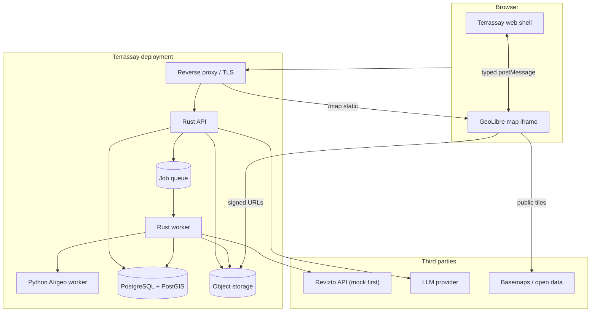
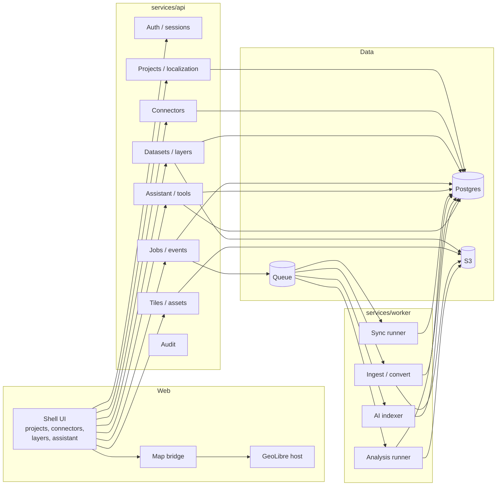
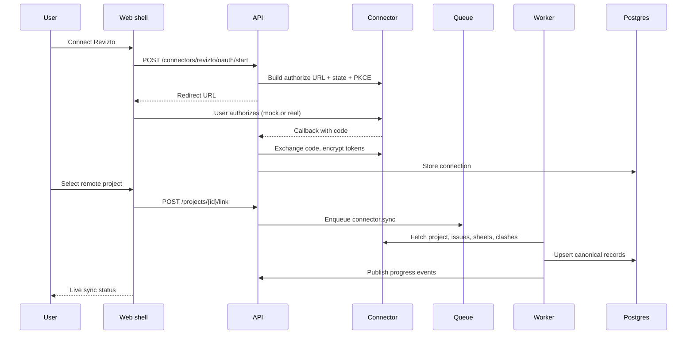
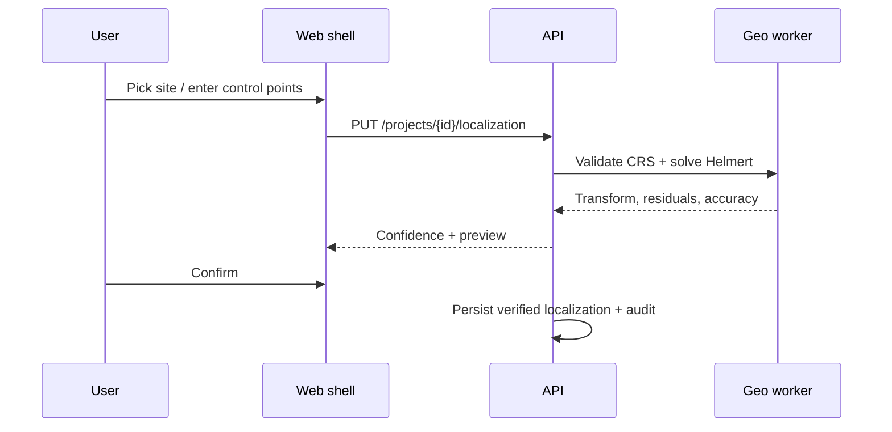
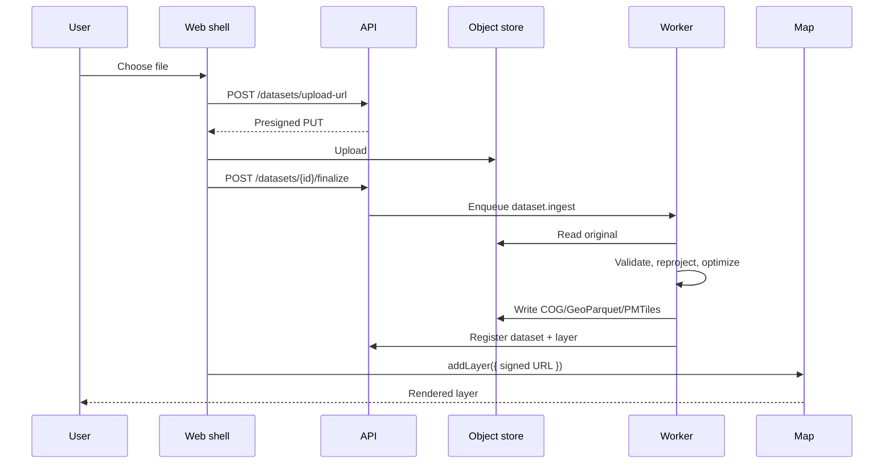
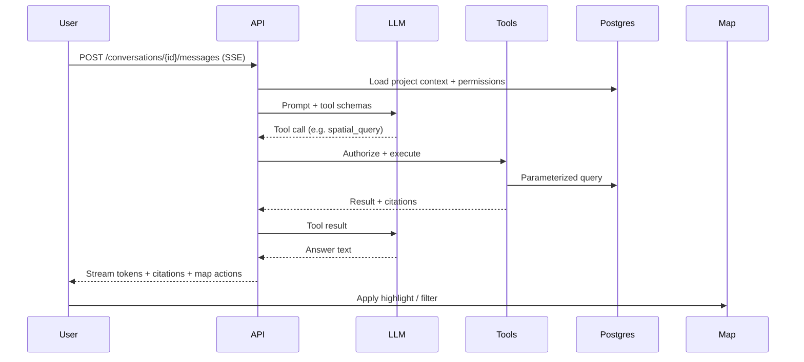

# Architecture

| | |
|---|---|
| **Status** | Proposed |
| **Scope** | Internal demo and self-hosted beta |
| **Related** | [BUILD_PLAN](BUILD_PLAN.md) · [DATA_MODEL](DATA_MODEL.md) · [API](API.md) · [SECURITY](SECURITY.md) |

---

## 1. Goals and constraints

**Goals**

- Place BIM coordination data in geographic context with an explicit, auditable georeference.
- Reuse a mature GIS surface instead of rebuilding one; keep the BIM-specific shell independently evolvable.
- Run on one machine with Docker Compose; no Kubernetes requirement.
- Keep the door open to multi-tenant hosting without rewriting the domain model.
- Make AI actions typed, permission-scoped, and auditable.

**Constraints**

- GeoLibre is embedded through its official build and embed API; no fork in the MVP.
- Revizto is mock-first; no geometry assumption.
- Rust for the core API/worker; Python only where the scientific ecosystem wins.
- Postgres/PostGIS is the system of record; object storage holds large assets.
- The demo is single-tenant and synthetic-data only.

---

## 2. System context



The browser never receives database credentials or vendor tokens. It receives short-lived signed URLs for assets and a session cookie for the API. The map iframe is same-origin, so private data can be fetched with the session cookie or a signed URL without CORS surprises.

---

## 3. Containers and responsibilities



### 3.1 Web shell (`apps/web`)

- React 19 + Vite + TypeScript strict.
- Routing: React Router; server state: TanStack Query; local UI state: Zustand.
- API client generated from OpenAPI (`openapi-typescript` + `openapi-fetch`), with Zod validation at the boundary.
- Feature folders: `projects`, `connectors`, `issues`, `datasets`, `layers`, `assistant`, `analysis`, `admin`.
- The shell is the **source of truth for project state**. The map is a projection; on reload or reconnect, the shell re-applies layers and view.

### 3.2 Map host (`apps/map-host`)

- Serves the pinned GeoLibre build under `/map/` on the same origin.
- Built from the official container image plus a runtime `deployment.json` that:
  - allowlists the shell origin for embeds;
  - grants only `data:add` and `export:data`;
  - denies `project:edit`, `processing:run`, and plugin installation;
  - disables analytics and external CDNs where self-hosting requires it.
- A first-party `terrassay-bridge` plugin is the fallback if the public embed API lacks a command. The plugin exposes only the same narrow commands; it does not become a general-purpose remote control.

### 3.3 Map bridge (`packages/map-bridge`)

A typed wrapper over `@geolibre/embed`:

```ts
interface MapSurface {
  ready(): Promise<void>;
  setView(v: { center: [number, number]; zoom: number; pitch?: number; bearing?: number }): Promise<void>;
  fitBounds(b: [number, number, number, number]): Promise<void>;
  addLayer(spec: LayerSpec): Promise<string>;
  removeLayer(id: string): Promise<void>;
  setVisibility(id: string, visible: boolean): Promise<void>;
  setFilter(id: string, expr: unknown): Promise<void>;
  highlight(ids: string[], layerId: string): Promise<void>;
  clearHighlight(): Promise<void>;
  getViewport(): Promise<Viewport>;
  exportImage(): Promise<string>;
  on(event: "selectionChanged" | "viewChanged" | "projectLoaded", cb: (p: unknown) => void): () => void;
}
```

Rules:

- Commands are **idempotent** where possible; each has a request ID and timeout.
- The bridge never sends credentials; it sends signed asset URLs or data references.
- Layer IDs are namespaced (`terrassay:<project>:<layer>`) to avoid collisions.
- The bridge checks the iframe origin and rejects messages from unexpected origins.
- Version compatibility is asserted at connect time; the map host version is pinned in the lockfile and the container image tag.

### 3.4 API (`services/api`)

A modular monolith. Each module has `domain`, `service`, `repo`, and `http` layers; cross-module calls go through service interfaces, not direct table access.

| Module | Responsibility |
|---|---|
| `auth` | Sessions, OIDC, dev login, CSRF, rate limits |
| `orgs` | Organisation, memberships, roles |
| `projects` | Projects, sites, saved views, summary |
| `localization` | Georeference records, control points, solve/validate |
| `connectors` | Connections, OAuth state, provider registry, sync runs |
| `datasets` | Upload/finalize, metadata, provenance, assets |
| `layers` | Layer records, styles, ordering, filters |
| `tiles` | MVT generation, caching, signed asset redirects |
| `issues` | Synced issues/clashes/sheets, search, aggregates |
| `jobs` | Enqueue, claim, progress, cancel, retry, SSE |
| `assistant` | Conversations, messages, tool registry, streaming |
| `analyses` | Analysis definitions, runs, results |
| `audit` | Append-only audit events |
| `health` | Liveness, readiness, version, metrics |

### 3.5 Worker (`services/worker`)

A separate binary using the same crates. It claims jobs from Postgres, runs them with a bounded concurrency, reports progress, and writes results.

Job types:

- `connector.sync`
- `dataset.ingest`
- `dataset.convert`
- `tiles.build`
- `analysis.run`
- `ai.index`
- `project.recompute_bbox`
- `maintenance.cleanup`

Each handler is idempotent, has a timeout, and records a structured error. Retries use exponential backoff with jitter; permanent failures are marked and surfaced in the UI.

### 3.6 Python AI/geo worker (`services/ai`)

An internal FastAPI service (no public ingress) for:

- GDAL/PDAL/rasterio/GeoPandas operations that are better expressed in Python.
- PyTorch inference (segmentation, detection, embeddings) when needed.
- Model-specific preprocessing.

It is stateless, authenticates with a service token, and receives asset references, not raw customer credentials. The Rust worker orchestrates it; it does not own project permissions.

---

## 4. Key flows

### 4.1 Connect and sync a BIM project



Details:

- OAuth state is single-use, expires in 10 minutes, and is bound to the session.
- Tokens are encrypted with a per-connection data key (envelope encryption).
- Sync is incremental where the API supports it; otherwise page through with a cursor and reconcile by `external_id` + `source_updated_at`.
- No webhooks; polling is scheduled with jitter and a per-connection rate budget.
- Sync writes are idempotent; a failed run resumes without duplicating records.

### 4.2 Localize a project



The transform is stored as structured parameters plus a 4×4 matrix, not as an opaque blob. The UI shows residuals and confidence before confirmation. A project can have only one active localization; history is retained.

### 4.3 Add a dataset and layer



The shell polls or subscribes to job progress. Ingestion is asynchronous so the UI never blocks on GDAL.

### 4.4 Ask the assistant



The model never receives a database handle. Tool arguments are validated against JSON Schema; the project ID and org ID come from the session, not the model. Every tool call is written to the audit log.

---

## 5. Data architecture

- **Postgres** is the system of record for projects, connections, localization, issues, layers, jobs, conversations, and audit.
- **Object storage** holds originals and derived assets, content-addressed by SHA-256.
- **DuckDB** is used inside workers for large GeoParquet scans and analytical joins; results are written back as assets or small tables.
- **No direct browser access to Postgres.** Tiles are generated by the API from PostGIS, or served as prebuilt PMTiles/COG from object storage.
- **Signed URLs** are short-lived (5–15 minutes), scoped to one object, and never expose bucket credentials.

See [DATA_MODEL](DATA_MODEL.md) for the schema and [GEOSPATIAL](GEOSPATIAL.md) for formats and tiling.

---

## 6. Frontend architecture

```text
apps/web/src/
├── app/                 # router, providers, error boundary
├── components/          # shared UI primitives
├── features/
│   ├── projects/        # list, create, overview
│   ├── connectors/      # connect, project picker, sync status
│   ├── localization/    # map pick, control points, confidence
│   ├── issues/          # map layer, filters, detail panel
│   ├── datasets/        # upload, metadata, provenance
│   ├── layers/          # layer tree, style, legend
│   ├── assistant/       # chat, tool trace, citations
│   ├── analysis/        # run, results, history
│   └── admin/           # connections, audit, settings
├── lib/
│   ├── api/             # generated client, error mapping
│   ├── map/             # MapSurface provider, layer specs
│   └── format/          # dates, numbers, CRS labels
└── styles/
```

UI rules:

- The map is always the visual anchor; panels are collapsible and keyboard accessible.
- Every layer row shows source, licence, and freshness.
- Every AI answer shows citations; clicking one selects the feature and flies the map.
- Destructive or write actions require a confirmation dialog that states exactly what will change.
- Loading and empty states are explicit; no infinite spinners.
- A "demo mode" banner is visible when synthetic data is in use.

Performance budgets:

| Metric | Budget |
|---|---|
| Shell initial JS (gzip) | ≤ 200 KB |
| Map iframe initial load | lazy, after shell skeleton |
| First meaningful map | ≤ 5 s warm, ≤ 10 s cold |
| Route transition | ≤ 150 ms |
| Layer toggle | ≤ 100 ms perceived |
| API p95 (project/issue queries) | ≤ 300 ms |
| Tile p95 | ≤ 500 ms |
| AI first token | ≤ 3 s |

---

## 7. Deployment

### 7.1 Demo / internal

```yaml
services:
  caddy:      # TLS, same-origin routing
  web:        # shell static build
  map:        # GeoLibre static build / official image
  api:        # Rust API
  worker:     # Rust worker
  postgres:   # PostGIS + pgvector
  storage:    # SeaweedFS (or MinIO for dev)
  # optional:
  ollama:     # local model
  prometheus:
  grafana:
```

- One command: `docker compose --profile demo up -d`.
- Seed on first boot; `just demo-reset` restores a known state.
- No public ingress; access through localhost or a private network.
- Backups: nightly `pg_dump` + object-store snapshot; restore tested monthly.

### 7.2 Self-hosted beta

- Same services, plus OIDC (Authentik/Keycloak), TLS, audit export, and a backup sidecar.
- Reverse proxy terminates TLS; the map host is served under the same origin.
- Resource target: 4 vCPU / 16 GB RAM / 100 GB SSD minimum; 8/32/500 GB recommended.
- Upgrade: forward-only migrations, backup before migrate, image tags pinned, rollback by tag.

### 7.3 Hosted (future)

- Kubernetes or Nomad; managed Postgres and object storage; per-tenant schema or row-level isolation.
- Queue moves to a managed broker only if Postgres contention is measured.
- Billing and SSO are separate services; the core domain model already carries `org_id`.

---

## 8. Failure handling

| Failure | Behaviour |
|---|---|
| LLM timeout | Stream an error, keep the conversation, allow retry; no partial write |
| Tool execution error | Return a structured error to the model; it may retry or explain |
| Connector rate limit | Back off, record `retry_after`, resume the cursor; UI shows "paused" |
| Worker crash | Job lease expires; another worker reclaims; handler is idempotent |
| Object storage unavailable | Uploads fail fast; existing tiles continue to serve from cache |
| Postgres failover | API returns 503 with `Retry-After`; no partial writes |
| Map iframe fails | Shell shows a fallback panel with a reload action and a link to open the map directly |
| Tile generation slow | Serve a lower zoom or a cached parent; show a loading state |

No silent data loss. Every job has a terminal state and an error message visible to the user.

---

## 9. Technology decisions

| Decision | Choice | Alternative considered | Why |
|---|---|---|---|
| Map surface | GeoLibre embed | Fork, build from scratch | Mature, MIT, typed embed API |
| API language | Rust | Python/FastAPI, Node | Performance, safety, single binary |
| Database | PostGIS | DuckDB-only, SpatiaLite | Transactions, concurrency, maturity |
| Queue | Postgres | Redis/Valkey, RabbitMQ | Fewer services, transactional |
| AI orchestration | Rust | Python | Permissions and audit in one place |
| Web framework | Vite SPA | Next.js | Interactive app, no SSR need |
| Object storage | S3 API | Local disk | Presigned URLs, scalability |
| Deployment | Compose | Kubernetes | Self-host simplicity |
| 3D | Cesium via GeoLibre | Custom Three.js | 3D Tiles, terrain, maturity |

---

## 10. Evolution path

1. **Demo:** single tenant, mock connector, 2D-primary with synthetic 3D massing, synthetic data.
2. **Pilot:** real Revizto, OIDC, IFC/3D Tiles, one pilot user.
3. **Beta:** connector SDK, collaboration, SSO, audit export, self-host docs.
4. **Hosted:** multi-tenant isolation, billing, managed pipelines, enterprise controls.
5. **Platform:** plugin ecosystem, marketplace, additional BIM connectors.

The seams that make this evolution possible are already in the plan: `org_id` on every row, a connector trait, a provider-agnostic AI layer, a versioned map bridge, and object storage behind signed URLs.
