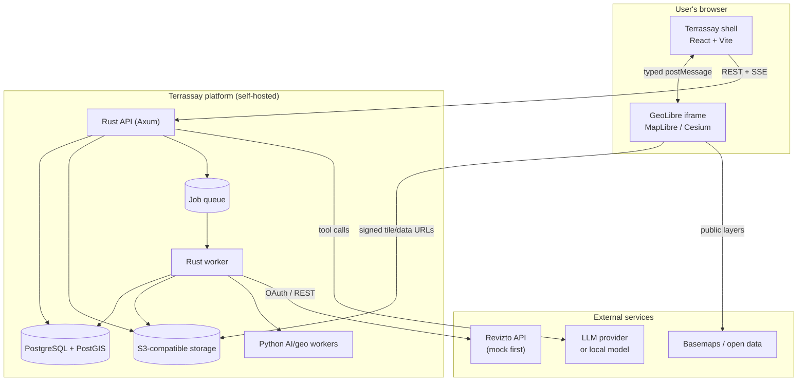

# Terrassay — Build Plan

| | |
|---|---|
| **Document** | Terrassay build plan |
| **Version** | 0.1 |
| **Date** | 4 November 2026 |
| **Status** | Proposed — for review |
| **Scope** | Internal demo → self-hosted beta |
| **Licence** | Apache-2.0 (core), subject to legal review |
| **Related** | [ROADMAP](ROADMAP.md) · [ARCHITECTURE](ARCHITECTURE.md) · [LEGAL_COMPLIANCE](LEGAL_COMPLIANCE.md) · [RISKS](RISKS.md) |

---

## 1. Executive summary

Terrassay is an open-source, self-hostable **site-intelligence workspace for construction**. It connects BIM coordination platforms to geographic data, places a project in its real-world context, and lets teams ask spatial questions with an AI assistant that cites its sources.

The product is deliberately **not** a general GIS and **not** a BIM viewer. The differentiated asset is the bridge between the two: a canonical project model, an explicit and auditable georeferencing workflow, construction-specific spatial analyses, and a connector architecture where Revizto is the first adapter rather than the product identity.

The first milestone is a **local-first open-source demo**, built by a **solo maintainer working with the DeepSeek Harness assistant**. It runs on **synthetic data** and a **mock Revizto connector**, so it needs no vendor credentials and creates no data-processing obligations. The demo proves six things: connect a BIM source, sync project metadata, place it on a map, overlay external geodata, show 3D site massing, and answer a grounded spatial question.

The map and analysis surface is **GeoLibre**, a mature MIT-licensed React/MapLibre/Cesium GIS workspace, reused through its typed iframe embed API and official container. Terrassay builds the BIM shell around it rather than rebuilding a generic GIS. This is the single biggest schedule and risk decision in the plan.

The backend is a **Rust modular monolith** (Axum + Tokio + SQLx) with **PostgreSQL/PostGIS** as the system of record, S3-compatible object storage, and a Postgres-backed job queue. Python is used where its scientific ecosystem is decisive (GDAL/PDAL/rasterio/PyTorch), not as the application brain. The AI orchestrator lives in Rust so permissions, audit, and tool execution stay in one place.

The plan is sized for **one maintainer working with the assistant**, not a funded team. Calendar estimates assume full-time focus; part-time work stretches them. The project is ongoing and community contributions are welcome, so milestones are more useful than fixed dates.

### GitHub identity: selected free setup

The project uses a **free GitHub organisation** and a **single human account**:

- **Human account:** `atpl-training` — owns the org, reviews, merges, handles billing. Agent commits are authored by this same account; there is no separate bot identity.
- **Organisation:** `terrassay` — free plan; public project identity.
- **Repository:** `terrassay/terrassay` — public; `main` protected.

No Pro, Team, or Enterprise plan is required for a public repo in a free organisation. There is **no second account and no automation identity**; `main` stays protected and merges are human.

**Legal position:** original code, synthetic data, no scraping, no redistribution of vendor data, licence-audited dependencies, and a **public pre-flight self-audit**. There is no budget for counsel yet, so the project stays in a synthetic-data, no-customer-data, no-paid-service posture; counsel review is required before real customer data, a commercial service, or a vendor-data integration. This plan is not legal advice.

### Headline numbers

| Item | Plan |
|---|---|
| First milestone | Local demo, 12–16 weeks full-time / 5–8 months part-time |
| Real Revizto connector | After API access; unscheduled |
| Self-hosted beta (v0.1) | Milestone-driven; no fixed date |
| Phase 1 effort | ~100 person-days |
| Total effort to beta | ~274 person-days (estimate, not a commitment) |
| Team | 1 maintainer + the assistant; community contributors |
| Cash to demo | <€50 first year (optional domain), excluding model usage |
| Infrastructure | Local Docker; free tiers; optional €5–20/month |
| Core licence | Apache-2.0 |
| First integration | Revizto (mock first) |
| 3D | Synthetic massing + terrain in the demo |

---

## 2. Starting constraints and decisions

These are fixed inputs from the project owner. They take precedence over generic best practice.

| # | Constraint | Consequence |
|---|---|---|
| C1 | Deliver a **full building plan + ADRs**, no application code yet | This document set is the deliverable; no scaffold is created |
| C2 | **Reuse GeoLibre** via embed/plugins; build the BIM shell separately | No fork; GeoLibre is a versioned dependency with a typed boundary |
| C3 | **No Revizto access yet**; plan around a mock + partner project | Mock connector is a first-class deliverable; real adapter follows access |
| C4 | **Local demo only** for now | Optimise for demo speed and safety; defer tenancy, SSO, and billing |
| C5 | **Free GitHub org, single human account** | Human `atpl-training` owns free org `terrassay`; no bot/machine account |
| C6 | **Human + assistant only** | No autonomous agent, no bot account, no auto-merge; human review |
| C7 | Everything must be **legal, open source, testing-only** | Clean-room, synthetic data, licence audit, self-audit before public |
| C8 | **Solo maintainer, no team, no budget** | Scope is cut to the demo; calendar is full-time/part-time dependent |
| C9 | **3D is in scope** | Synthetic massing + terrain; still no Revizto model geometry |
| C10 | **Anyone can contribute and test** | Public repo from bootstrap, DCO, CI, good-first-issues |

### Planning assumptions

- One maintainer works with this assistant; there is no paid team.
- The repository is **public from bootstrap**, contains only synthetic data, and carries a "planning/testing" disclaimer.
- The demo runs locally with Docker Compose; hosted infrastructure is optional and free-tier only.
- Basemaps and data use open licences and attribution; local models are the default AI option.
- Revizto API access is not required for the demo and will be added when available.
- "Terrassay" is the chosen name, subject to the preliminary clearance in [NAMING](NAMING.md).
- 3D uses synthetic extruded building footprints and terrain, not Revizto geometry.

---

## 3. What the research changed

### 3.1 GeoLibre already covers most of the generic GIS surface

GeoLibre is an MIT-licensed, React-based GIS workspace with MapLibre, Cesium, deck.gl, DuckDB-WASM, a plugin API, a Python sidecar, a typed embed client, self-hosting, and a large processing toolbox ([architecture](https://geolibre.app/architecture/), [embedding](https://geolibre.app/user-guide/embedding/), [plugin API](https://geolibre.app/plugin-api/)). It already does the things a from-scratch Terrassay would spend months rebuilding: layer management, COG/PMTiles/point-cloud rendering, styling, attribute tables, basemaps, and 3D.

**Decision:** do not fork and do not rebuild. Embed GeoLibre as the map surface. Build the differentiated shell — projects, BIM connectors, georeferencing, analyses, AI, audit — around it.

The embed API is real and typed: `@geolibre/embed` provides `addLayer`, `addData`, `setView`, `setFilter`, `highlightFeature`, `getViewport`, `exportImage`, `getLayerFeatures`, and events such as `selectionChanged`, `viewChanged`, and `projectLoaded`. It is disabled unless the deployment allowlists the host origin, and commands are gated by deployment capabilities. That is a sound security boundary for our use.

**Residual risk:** the embed API may not expose every control we want (for example basemap switching or custom 3D camera behavior). Phase 0 includes a three-day spike to prove the exact flows. If the spike fails, the fallback is a first-party GeoLibre plugin loaded into a custom map host, not a fork.

### 3.2 Revizto provides coordination data, not model geometry

Revizto's API is now OAuth 2.0, managed through the Developer Portal, with regional hosts and per-user access ([developer portal](https://help.revizto.com/hc/en-us/articles/16924350271119-Revizto-developer-portal)). It exposes projects, issues, comments, clashes, sheets, reports, users, and licences. The MCP server explicitly does **not** expose model import/export, screenshots/images, webhooks, or logs ([MCP limitations](https://help.revizto.com/hc/en-us/articles/16924308080271-Connecting-AI-tools-to-Revizto-MCP-server)).

That means:

- We can sync **project metadata, issues, clashes, sheets, and object properties** (object properties require *Extended API access* on the project).
- We cannot assume we can pull the **3D model** or a **georeferenced site boundary** through the API.
- **No webhooks are documented**, so synchronisation is polling with cursors and ETags.
- The exact issue coordinates, scene metadata, scopes, pagination, and rate limits are **unconfirmed** and must be validated with a real account.

**Decision:** the demo is honest about this. It uses a mock connector with realistic fixtures, and the product treats georeferencing as an explicit user-confirmed workflow. Full BIM geometry is out of scope for the demo; later it arrives through IFC/3D Tiles/Speckle, not through a fictional Revizto geometry endpoint.

### 3.3 Licensing is an architecture input, not paperwork

Several otherwise attractive components carry licences that need care:

- **PostGIS** is GPL-2.0-or-later. Running it as a separate database service is the intended architecture; distribution obligations still need counsel review.
- **Redis** changed its licence; **Valkey** (BSD-3-Clause) is the safer default for a self-hosted open-source distribution.
- **MinIO**'s server licence needs review; **SeaweedFS** (Apache-2.0) is the default for distribution, with MinIO acceptable for local development.
- **pyRevizto** is GPL-3.0. It is listed only to flag the licence risk; we do not copy or link it into Apache-2.0 code.
- **GeoLibre** is MIT and embeddable, but its bundled engines, basemaps, and Cesium Ion integration have their own terms.

**Decision:** licence compatibility is checked in CI, high-risk dependencies are isolated behind process boundaries, and a self-audit precedes the public repository. Counsel review is required before customer data or a commercial service, not for the synthetic demo. See [LEGAL_COMPLIANCE.md](LEGAL_COMPLIANCE.md).

---

## 4. Product definition

### 4.1 Users and jobs to be done

| Persona | Job to be done | What Terrassay gives them |
|---|---|---|
| **VDC / BIM coordinator** (primary) | "Put this project in context and tell me what spatial risks affect coordination." | Project location, issue/clash map, site overlays, grounded briefs |
| **Site manager** | "Show me open issues and constraints around the work face." | Filtered map, access/flood/utility layers, mobile-friendly read-only views (later) |
| **Geospatial analyst** | "Bring site data in and query it against the project record." | GeoParquet/COG/PMTiles ingestion, PostGIS SQL, typed spatial tools |
| **Project manager / owner** | "Summarise status and risk with evidence." | AI summaries with citations, exportable briefs |
| **IT / security** | "Keep our models and site data inside our infrastructure." | Self-hosted Compose deployment, local AI option, audit log |

### 4.2 Demo capabilities

1. **Connect a BIM account.** OAuth-shaped flow, project picker, connection status, disconnect/revoke.
2. **Select a project and retrieve metadata.** Name, code, region, units, status, members, issue/clash/sheet counts, last sync.
3. **Display the project on a map.** Confirmed location, site boundary, issue/clash points, sheets linked to locations.
4. **Overlay external geographic datasets.** GeoJSON, COG, XYZ/PMTiles, with styling, legend, opacity, and attribution.
5. **Show 3D site massing.** Synthetic extruded building footprints and terrain in the globe; a context view, not a BIM review.
6. **Ask an AI assistant to investigate.** Typed tools for project summary, issue search, spatial queries, layer control, and analysis; answers with citations and map actions.

### 4.3 Explicit non-goals for the demo

- Full BIM geometry viewing or authoring; the 3D massing is synthetic context, not model review.
- Clash detection (we display Revizto clashes, we do not compute them).
- 4D scheduling, reality capture, or photogrammetry.
- General-purpose GIS editing or a plugin marketplace.
- Multi-tenant SaaS, billing, SCIM, or public sign-up.
- Survey-grade certification or legal reliance on coordinates.
- Real-time collaboration or mobile apps.
- A public production deployment with customer data.

### 4.4 Product principles

1. **Site context first.** The map is the workspace, not a widget.
2. **Never invent geography.** Every location has a source, a CRS, an accuracy estimate, and a confidence label.
3. **Open formats in, open formats out.** GeoJSON, GeoParquet, COG, PMTiles, 3D Tiles.
4. **Self-hosting is first-class.** No mandatory cloud dependency for core workflows.
5. **AI shows its work.** Tools are typed, calls are audited, answers cite records, writes need confirmation.
6. **Reuse over rebuild.** Upstream improvements to GeoLibre where possible.
7. **Honest demos.** Mock data and mock connectors are visibly labelled.

---

## 5. The demo

### 5.1 Narrative (ten minutes)

**Scene 1 — Project context (0:00–1:30).**
Sign in as "A. Keller, VDC Lead". The Hafenquartier Zürich project opens with a site boundary, a hillshade, and an orthophoto. A badge reads *"Location verified by 3 control points · RMS 0.18 m"*. The project summary shows 240 issues, 60 critical, 3 clashes, 12 sheets.

**Scene 2 — Connect Revizto (1:30–3:00).**
Click **Connect Revizto**. A consent screen clearly labelled **"Revizto sandbox (mock)"** asks for read-only access. Pick the project. A sync job streams progress: metadata, 240 issues, 12 sheets, 3 clashes. The issues appear as a clustered layer; the sheet list fills in.

**Scene 3 — Investigate (3:00–5:30).**
Filter to critical issues. Click one: the detail panel shows status, assignee, due date, sheet reference, and coordinates. The map flies to it. Toggle the flood-hazard polygon and the noise raster. The legend explains both. The layer panel shows source, licence, and attribution. Switch on **3D massing** to see the six synthetic buildings extruded over the terrain; the badge says *"Synthetic massing · no Revizto geometry"*.

**Scene 4 — Ask (5:30–8:00).**
Ask: *"Which critical issues are inside the flood zone?"* The assistant calls `spatial_query`, highlights seven issues, opens a result table, and cites the issue IDs and the flood dataset. Ask: *"Draft a stand-up brief for tomorrow."* It produces counts by discipline, the top three overdue items, and links to sources. A **"Create comment"** action is shown but requires confirmation; no write occurs.

**Scene 5 — Trust and operate (8:00–10:00).**
Open the job log and audit trail. Show the georeferencing details: source CRS, method, residuals, verifier. Show the "reset demo" command. Close on the one-command install and the open-source repository.

### 5.2 Demo fixture: Hafenquartier Zürich (fictional)

| Item | Value |
|---|---|
| Location | 47.3845° N, 8.5170° E (Zürich West, fictional site) |
| Site area | ~4.2 ha |
| Buildings | 6 (2 offices, 1 residential, 1 hotel, 1 retail podium, 1 energy centre) |
| Issues | 240 (60 critical, 80 high, 100 normal); 4 disciplines; 8 assignees |
| Clashes | 3 (structure/MEP, façade/structure, landscape/utilities) |
| Sheets | 12 (architectural, structural, MEP, landscape) |
| Control points | 3, with known E/N; residuals 0.11–0.24 m |
| External layers | Flood hazard polygon (cantonal open data, attributed), hillshade COG (SwissALTI3D-derived), OSM/PMTiles basemap, synthetic utilities GeoJSON |
| 3D | 6 synthetic extruded buildings, terrain/hillshade; clearly labelled sample geometry |
| AI golden questions | 10 in the demo; 25 in the eval set |

All project records are synthetic. External datasets use openly licensed sources with attribution, or are synthetic where licensing is uncertain. No Revizto data is used.

### 5.3 Demo success criteria

| Criterion | Threshold |
|---|---|
| Fresh bootstrap on a clean machine | `docker compose up` + seed < 10 minutes |
| Rehearsal | 3 consecutive runs, each < 12 minutes, no manual fixes |
| Six demo capabilities | All demonstrated end-to-end, including 3D massing |
| Map readiness | First meaningful map < 5 s on a warm cache |
| API latency | p95 < 300 ms for project/issue queries |
| AI responsiveness | First token < 3 s; full answer < 20 s |
| Grounding | 100% of factual claims have a citation or a tool result |
| Security | No critical/high findings in the demo threat review |
| Legal | Launch-gate checklist green for demo scope |
| Determinism | Reset + reseed < 60 s; AI mock mode available |

### 5.4 Fallbacks

- **LLM unavailable:** `AI_PROVIDER=mock` returns pre-recorded, tool-grounded responses; the demo still shows the tool-call trace.
- **Network unavailable:** local PMTiles basemap, cached COG, local Ollama model; reduced but functional.
- **GeoLibre embed issue:** fall back to the custom map-host plugin (Phase 0 decision gate).
- **Revizto access arrives early:** keep the mock as the default demo; use the real connector behind a flag, never with customer data in the demo.
- **Tile latency:** pre-render a static PMTiles snapshot for the demo extent.

---

## 6. Architecture

### 6.1 System context



### 6.2 Components

| Component | Responsibility | Technology |
|---|---|---|
| **Web shell** | Projects, connectors, layers, issues, assistant, admin | React 19, Vite, TypeScript, Tailwind, shadcn/ui, TanStack Query, Zustand |
| **Map host** | Map, 3D globe, layer rendering, COG/PMTiles/point clouds | GeoLibre 3.6.x, MapLibre, CesiumJS, deck.gl |
| **Map bridge** | Typed command/event boundary | `@geolibre/embed` pinned, wrapped by `@terrassay/map-bridge` |
| **API** | Auth, projects, connectors, datasets, layers, jobs, AI, audit | Rust, Axum, Tokio, SQLx, utoipa |
| **Worker** | Sync, ingest, tiling, analyses, indexing | Rust, Tokio; shares domain crates |
| **AI/geo workers** | Raster/vector/LiDAR processing, CV inference | Python, FastAPI (internal), GDAL, PDAL, rasterio, GeoPandas, PyTorch |
| **Database** | System of record, spatial queries, queue, audit | PostgreSQL 17 + PostGIS 3.5 + pgvector |
| **Object storage** | Raw uploads, derived assets, tiles | S3 API; SeaweedFS for distribution, MinIO for dev |
| **Queue** | Durable jobs with retries and progress | Postgres `SKIP LOCKED`; Valkey optional for cache/rate limits |
| **Reverse proxy** | TLS, routing, same-origin map host | Caddy or Traefik |

### 6.3 Why this shape

**Modular monolith, not microservices.** At demo scale (one team, one project, hundreds of issues), microservices add operational cost and distributed failure modes without benefit. The API and worker are separate binaries sharing one domain crate; they can be split later along existing seams.

**PostGIS as the system of record.** Spatial integrity, transactions, and permissions belong in one place. DuckDB is used for analytical scans over large GeoParquet files, not as the primary store.

**Postgres job queue first.** A `jobs` table with `FOR UPDATE SKIP LOCKED`, `LISTEN/NOTIFY`, retries, and idempotency keys is sufficient for this workload and removes Redis from the self-host critical path. Valkey is added only for caching or rate limiting if measurements demand it. This is a deliberate deviation from the original stack table; see [ADR-0006](adr/0006-job-queue.md).

**Rust AI orchestration.** The agent loop, tool registry, permission checks, and audit live beside the domain API. Python handles model inference and heavy geospatial processing, where its ecosystem is strongest. This avoids a second authorization surface in Python.

**GeoLibre embedded, not forked.** The shell controls product UX; GeoLibre controls rendering. The boundary is a versioned protocol, so either side can be upgraded independently. A custom map-host plugin is the escape hatch if the embed API is insufficient.

### 6.4 Stack decisions

| Layer | Choice | Version (target) | Why |
|---|---|---|---|
| Web | React + Vite + TypeScript | React 19, Vite 7, TS 5.7+ | Fast SPA, no server-rendering requirement |
| UI | Tailwind + shadcn/ui | Tailwind 4 | Consistent, accessible primitives; small owned surface |
| Map | GeoLibre + MapLibre | GeoLibre 3.6.x, MapLibre 5.x | Reuse; 2D performance; open licence |
| 3D | CesiumJS via GeoLibre | 1.13x | Globe, terrain, 3D Tiles; lazy-loaded |
| 3D overlays | deck.gl via GeoLibre | 9.x | Point clouds, aggregated layers |
| API | Rust + Axum + Tokio + SQLx | Rust stable, Axum 0.8, SQLx 0.8 | Performance, safety, predictable ops |
| Database | PostgreSQL + PostGIS | PG 17, PostGIS 3.5 | Mature spatial database |
| Analytics | DuckDB Spatial | 1.4+ | Columnar scans over GeoParquet |
| Geo processing | GDAL + PROJ + PDAL | GDAL 3.10+, PROJ 9.5+, PDAL 2.8+ | Format and CRS coverage |
| AI | Provider-agnostic; Python for inference | OpenAI-compatible + local | Avoid lock-in; local option |
| Jobs | Postgres queue; Valkey optional | — | Fewer moving parts; transactional |
| Storage | S3 API | — | Presigned URLs, range requests |
| Deployment | Docker Compose | — | Self-host first; Helm later |

### 6.5 Deployment topology

**Demo / internal:** one Docker Compose stack — `web`, `map`, `api`, `worker`, `postgres`, `object-store`, `caddy` — with a seed profile. Optional `ollama` for local AI. Single host, 8 vCPU / 32 GB RAM / 200 GB SSD.

**Self-hosted beta:** the same stack with OIDC, TLS, backups, audit export, and a reverse proxy. 4 vCPU / 16 GB RAM minimum; 8 vCPU / 32 GB recommended.

**Hosted (later):** Kubernetes or Nomad, managed Postgres and object storage, per-tenant isolation, billing. Not part of this plan's build.

---

## 7. Data and georeferencing

The full schema and CRS rules are in [DATA_MODEL.md](DATA_MODEL.md) and [GEOSPATIAL.md](GEOSPATIAL.md). The decisions that matter for the plan:

- All geometries are stored in **EPSG:4326** with a Z coordinate where available.
- Each project has an **analysis CRS** (for example EPSG:2056 in Switzerland) used for buffers, distances, and areas.
- **Vertical datum is recorded explicitly**; ellipsoidal and orthometric heights are never silently mixed.
- A project's location is a **reviewable record**, not a hidden transform: method, source CRS, target CRS, transform parameters, control points, residuals, accuracy, confidence, verifier, and timestamp.
- Georeferencing methods, in order of confidence: API-provided georeference → surveyed control points → map pick + rotation/scale → address geocode. The UI labels each result **Verified**, **Calculated**, or **Indicative**.
- **No survey-grade claims.** The product communicates accuracy; it does not certify it.
- Every dataset carries **provenance and licence/attribution** fields. External data without a licence cannot be published in a shared project.

The demo's hardest honest moment is showing a *confirmed* location with residuals, rather than pretending the BIM model arrived georeferenced.

---

## 8. Revizto integration

Full detail: [REVIZTO_CONNECTOR.md](REVIZTO_CONNECTOR.md).

### What we know

- OAuth 2.0 via the Developer Portal; custom app with client ID/secret; exact redirect URIs; HTTPS (localhost exempt); account-level API enablement; owners/admins manage apps.
- Regional API hosts (`api.<region>.revizto.com`); authorization and token endpoints under `/v5/oauth2/`.
- Per-user access: the integration can only see what the authorizing user can see.
- Data available includes projects, issues, comments, clashes, sheets, reports, users, licences; object properties require Extended API access.
- No webhooks, no model import/export, no screenshots through MCP.
- API docs are at [developer.revizto.com](https://developer.revizto.com/); exact scopes, pagination, rate limits, and geometry fields must be confirmed with a real account.

### Strategy

1. **Mock first.** Implement a `BimConnector` trait and a `MockReviztoProvider` that returns fixtures matching the canonical model. The mock OAuth screen is clearly labelled and lives in our app.
2. **Contract tests.** The real adapter must pass the same normalisation tests as the mock; fixtures are versioned.
3. **Real adapter behind a flag.** When access arrives, implement OAuth + project/issue/sheet/clash sync, validate against a partner project, and keep the mock for demos and CI.
4. **No geometry assumption.** If the API exposes issue coordinates or scene metadata, use them with provenance. If not, georeference the site and issue locations explicitly; import 3D geometry from IFC/3D Tiles later.
5. **Polling, not webhooks.** Incremental sync with cursors/ETags, exponential backoff, rate-limit budget, idempotent upserts, and a visible sync status.
6. **Least privilege.** Read-only scopes for the demo; write scopes only when a confirmed feature needs them. Tokens encrypted at rest; revoke on disconnect.

### Access checklist (owner/admin)

- [ ] Confirm API access is enabled at the account level.
- [ ] Create a custom OAuth app in the Developer Portal.
- [ ] Register exact redirect URIs (localhost for dev, HTTPS for deployed).
- [ ] Record the client ID and secret in a secrets manager (never chat or git).
- [ ] Confirm the region and API base URL.
- [ ] Confirm available scopes, pagination, rate limits, and token lifetime.
- [ ] Confirm whether issue/clash/sheet records carry coordinates or a model transform.
- [ ] Enable Extended API access on the test project if object properties are needed.
- [ ] Provide a partner project or approve synthetic fixtures only.
- [ ] Confirm terms for caching, retention, and derived data.

---

## 9. AI assistant

Full detail: [AI_ASSISTANT.md](AI_ASSISTANT.md).

The assistant is a **tool-using agent**, not a chatbot over a vector store. It runs a bounded loop in Rust: build context → choose a typed tool → execute with the user's permissions → observe → answer with citations. It cannot execute raw SQL, shell commands, or arbitrary HTTP.

MVP tools:

| Tool | Purpose |
|---|---|
| `get_project_summary` | Counts, status, bbox, last sync, data freshness |
| `search_issues` | Filter by status, priority, discipline, assignee, bbox, text |
| `aggregate_issues` | Group/count by discipline, status, priority, assignee |
| `spatial_query` | Intersects/within/distance against an allowlisted layer |
| `list_layers` / `add_layer` / `set_layer_visibility` | Map control |
| `zoom_to_features` / `highlight_features` | Spatial grounding |
| `run_analysis` | Buffer/count, intersect, nearest, elevation sample |
| `draft_issue_comment` | Preview only; write requires confirmation |

Guardrails:

- **Grounding:** no coordinate from the model; coordinates come from tools. Every factual claim cites a record or dataset.
- **Permissions:** tools receive `org_id`/`project_id` from the session, never from the model. Cross-project access is impossible by construction.
- **Writes:** disabled by default; a write requires an explicit UI confirmation and is audited.
- **Prompt injection:** project text is untrusted data; system instructions never come from synced content.
- **Budgets:** max 8 tool calls, 60 s tool timeout, token and cost caps per conversation.
- **Evals:** 25 golden questions with expected tools/facts; deterministic mock in CI, real-model run nightly.
- **Local option:** Ollama/vLLM for self-hosted deployments that cannot send data to a hosted model.

---

## 10. Development workflow

- The project is built **interactively** by the maintainer with the DeepSeek Harness assistant.
- There is **no autonomous coding agent**, no bot account, and no auto-merge.
- Every change is reviewed, tested, and committed by the maintainer.
- AI-assisted changes are disclosed where relevant.
- The assistant has access to the local workspace, not to GitHub credentials or production secrets.

## 11. GitHub organisation and identity

Full checklist: [GITHUB_ORG_SETUP.md](GITHUB_ORG_SETUP.md).

The selected setup uses a **free organisation** and a **single human account**:

- **Human account:** `atpl-training` owns the free organisation `terrassay`; reviews, merges, and handles billing.
- **Organisation:** `terrassay` on the Free plan. No Pro, Team, or Enterprise is required for a public repo.
- **Repository:** `terrassay/terrassay`, public from bootstrap, with branch protection, CODEOWNERS, secret scanning, Dependabot, and a read-only `GITHUB_TOKEN`.
- **Clean history:** no personal email addresses, personal SSH keys, or imported private commits.

**Honest limitation:** a GitHub organisation must be owned by a user account, and ownership is not anonymous to GitHub or to org members. This setup gives the project a clean public identity, but it does not make ownership untraceable. A second **free human** account is not permitted, and is not used.

The repository is public from bootstrap, after the [Gate A self-audit](LEGAL_COMPLIANCE.md#12-launch-gates). Counsel is required before customer data or a paid service (Gate B), not for the synthetic demo.

---

## 12. Legal and compliance

Full detail: [LEGAL_COMPLIANCE.md](LEGAL_COMPLIANCE.md).

Non-negotiables for the testing phase:

1. **Original code.** No copying from proprietary tools, no decompiling, no scraping, no unlicensed snippets.
2. **Synthetic data only.** No Revizto project data, no customer models, no personal data. Mock records are fictional and labelled.
3. **Official APIs only.** When Revizto access is granted, use OAuth, respect scopes and rate limits, and never redistribute project data.
4. **Licence hygiene.** Apache-2.0 core; dependency inventory; CI checks (`cargo-deny`, licence scanner, SBOM); GPL/AGPL components isolated behind process boundaries; counsel review before commercial distribution.
5. **Trademarks.** Terrassay is the chosen name (preliminary clearance); do not use Revizto, GeoLibre, or DeepSeek marks in the product name or logo. Nominative references only, with a non-affiliation disclaimer.
6. **AI provenance.** AI-assisted code is reviewed by a human, scanned for copied material, and disclosed in the PR. No customer data goes to a model provider without a data-processing agreement.
7. **Two gates.** The public synthetic repo uses the Gate A self-audit (licences, trademarks, data, AI disclosure). Gate B requires counsel before customer data, a paid service, or a vendor-data integration.

This is not legal advice. Gate A is a self-audit; reserve €5k–€15k for Gate B when a commercial step appears.

---

## 13. Delivery plan

Detailed phases, work breakdown, and staffing scenarios: [ROADMAP.md](ROADMAP.md).

### 13.1 Phases

| Phase | Timing | Outcome | Gate |
|---|---|---|---|
| **0 — Bootstrap & validation** | Weeks 1–2 | New account/org, licence and naming baseline, GeoLibre spike, demo fixture, mock contract | Embed spike passes; fixtures ready; public pre-flight checklist v0 |
| **1 — Demo MVP** | Weeks 3–18 (12–16 working weeks) | Six demo capabilities including 3D massing, synthetic demo, one-command local install | 3 clean rehearsals; demo scorecard; security self-review |
| **2 — Real connector & pilot** | After Revizto access | Revizto OAuth/sync, OIDC, IFC/3D Tiles, pilot with one partner | Partner project synced; 5 users; external review |
| **3 — Self-hosted beta** | Ongoing | Connector SDK, collaboration, SSO, docs, release 0.1 | 3 active pilot users; upgrade/backup tested; self-audit |

There is no fixed beta date. Phase 2 depends on API access; Phase 3 depends on community momentum and available time.

### 13.2 Effort estimate

| Phase | Person-days | Calendar (solo + AI) |
|---|---:|---|
| 0 — Bootstrap | 12 | 2 weeks |
| 1 — Demo MVP | 100 | 12–16 weeks full-time |
| 2 — Real connector + pilot | 80 | 8–10 weeks full-time after access |
| 3 — Self-hosted beta | 82 | Ongoing; community-dependent |
| **Total** | **274** | **Not a deadline** |

Phase 1 breakdown:

| Epic | Deliverable | PD |
|---|---|---:|
| E0 | Repo, CI, Compose skeleton, coding standards | 4 |
| E1 | Demo fixtures, narrative, reset/seed | 6 |
| E2 | Core model + projects API | 9 |
| E3 | Dev auth/session | 4 |
| E4 | GeoLibre map host + bridge | 10 |
| E5 | Georeferencing workflow | 7 |
| E6 | Mock connector + sync | 9 |
| E7 | Issues/clashes map UX | 9 |
| E8 | Datasets and layers | 8 |
| E9 | AI assistant + tools + evals | 12 |
| E10 | Spatial analyses | 6 |
| E11 | Jobs, progress, audit | 5 |
| E12 | Deployment, observability, docs | 4 |
| E13 | QA, rehearsal, demo packaging | 3 |
| E14 | 3D massing + terrain scene | 4 |
| | **Total** | **100** |

### 13.3 Staffing scenarios

| Mode | Demo | Beta | Notes |
|---|---:|---:|---|
| Solo, full-time + assistant | 12–16 weeks | 6–9 months | **Plan baseline** |
| Solo, part-time (~20 h/week) | 5–8 months | 12–18 months | Most likely for an unfunded project |
| Solo + regular contributors | 10–14 weeks | 5–8 months | Community review accelerates, but coordination costs |
| Paid team | 8–12 weeks | 4–6 months | Not funded; included only for comparison |

AI leverage is assumed for tests, docs, fixtures, and small features. It does not remove the need for human review, integration, or demo polish.

### 13.4 Budget (near-zero)

| Item | Demo | Ongoing |
|---|---:|---:|
| Domain | €0–15/year | €0–15/year |
| GitHub Free org/repo | $0 | $0 |
| Hosting | €0 (local Docker) | €0–20/month optional |
| AI models | €0 local, or usage-based | Variable |
| Legal | €0 self-audit | Save for review before customer data |
| Design/team | €0 | €0 |
| **Total** | **<€50 first year**, excluding model usage | **<€250/year**, excluding model usage |

Assumptions: existing hardware, free/open basemaps, GitHub Free organisation/public-repo features, and local models where possible. There is no paid GitHub plan.

---

## 14. Risks

Top risks; full register with triggers and owners in [RISKS.md](RISKS.md).

| # | Risk | L | I | Mitigation | Trigger |
|---|---|---|---|---|---|
| R1 | Revizto API lacks geometry/georeference, or access is delayed | H | H | Mock-first; explicit localization; IFC/3D Tiles fallback; partner access | No test project by week 4 |
| R2 | GeoLibre embed cannot support required interactions | M | H | 3-day spike; custom map-host plugin; fork as last resort | Spike fails in week 1 |
| R3 | Scope creeps into general GIS or full BIM viewer | H | H | Non-goals; demo gate; GeoLibre reuse | New epic not tied to six capabilities |
| R4 | Georeferencing errors create liability | M | H | Confidence labels; residuals; disclaimers; no survey-grade claims | User asks for "exact" placement |
| R5 | AI hallucination or prompt injection | M | H | Typed tools; citations; read-only; evals; injection tests | Any uncited spatial claim |
| R6 | Licence contamination (GPL/AGPL, copied code) | M | H | Inventory; process isolation; clean-room; CI; counsel before commercial | New dependency without review |
| R8 | New org/identity setup blocks progress | L | M | Bootstrap in week 1; human-only org path; documented | No org by day 3 |
| R9 | Self-host complexity kills adoption | M | M | Compose profiles; one command; diagnostics; docs | Install > 30 min |
| R10 | Performance degrades with large projects | M | M | MVT/COG/PMTiles; clustering; budgets; load tests | p95 > 1 s at 10k issues |
| R11 | Solo maintainer burnout or capacity loss | H | H | Narrow scope; milestone-driven; AI leverage; public "not doing" list | Missed milestone by >4 weeks |
| R12 | No budget for legal review | H | M | Synthetic data only; self-audit; no customer data; defer commercial launch | A real project or paid service is proposed |
| R13 | No budget for hosting/AI | M | M | Local Docker; free tiers; local models; no public SaaS | Monthly cost exceeds €20 |

---

## 15. Licensing and community

Full detail: [LICENSING_BUSINESS.md](LICENSING_BUSINESS.md).

- **Core licence:** Apache-2.0, with a DCO and no CLA. This maximises adoption and patent comfort.
- **No commercial tier now.** There is no paid edition, no open-core paywall, and no pricing. The project is open source, free to self-host, and funded by time, not revenue.
- **Connectors:** the connector SDK and Revizto adapter are open source. Credentials and customer data are never bundled.
- **Sustainability later:** donations, sponsorships, or paid support only if the community asks and the legal/accounting position is clear. No relicensing of community contributions.
- **Revizto relationship:** comply with API terms; do not imply endorsement; do not redistribute project data.
- **Community:** public roadmap, ADRs, good-first-issues, code of conduct, security policy, and upstream GeoLibre contributions.
- **No vendor lock-in:** open formats and a provider-agnostic AI layer are part of the licence promise.

---

## 16. Metrics

**Demo scorecard:** rehearsal time, six-capability pass rate (including 3D massing), map readiness, API p95, AI first token, citation coverage, zero critical security findings, public pre-flight checklist.

**Project health:**

- Time to first map for a new contributor.
- Install success on a clean machine.
- Issue/PR response time.
- CI pass rate.
- Contributor count and good-first-issue completion.
- AI answer acceptance rate and citation coverage.
- Self-host installs and upgrade success.

**No business metrics yet.** There is no revenue target, no paid funnel, and no customer data. Analytics are off by default; any telemetry is opt-in and documented.

---

## 17. Decisions and open questions

### Decisions taken in this plan

| ID | Decision | Status |
|---|---|---|
| D1 | Reuse GeoLibre via embed; build a separate BIM shell | Accepted |
| D2 | Mock-first Revizto connector | Accepted |
| D3 | Local demo, synthetic data, single tenant | Accepted |
| D4 | Rust modular monolith (API + worker) | Proposed |
| D5 | PostGIS system of record; DuckDB analytics | Proposed |
| D6 | Postgres job queue; Valkey optional | Proposed |
| D7 | AI orchestration in Rust with typed tools | Proposed |
| D8 | Apache-2.0, DCO, no commercial tier for now | Proposed |
| D9 | Free org `terrassay` owned by `atpl-training`; no bot/machine account; no paid plan | Accepted |
| D10 | Human + assistant development; no autonomous agent, no auto-merge | Accepted |
| D11 | No Revizto model geometry in the demo; 3D is synthetic massing | Accepted |
| D12 | Public pre-flight self-audit; counsel before customer data or commercial service | Accepted |
| D13 | Project name: Terrassay (preliminary clearance) | Accepted |
| D14 | 3D massing + terrain in the demo | Accepted |

### Open questions

1. **Handle confirmation.** Confirm `atpl-training`, org `terrassay`, and repo `terrassay/terrassay`.
2. **Domain registration.** Register `terrassay.com` / `.dev` now, or defer? The name is only preliminary until reserved.
3. **Revizto access.** When available, who is the account owner/admin, and is there a test project?
4. **AI provider.** Default to local models for zero cost/sovereignty, or use a hosted model for demo quality? The plan supports both.
5. **Public repository timing.** The plan assumes public from bootstrap with synthetic data. Confirm you are comfortable with that.
6. **3D depth.** Synthetic massing only, or a small open 3D Tiles sample as a visual teaser? Massing is the default.
7. **Trademark review.** Defer until a commercial launch, or run a free knock-out search before public? The plan recommends the free search now.

---

## 18. First 14 days

| Day | Work | Owner | Done when |
|---|---|---|---|
| 1 | Confirm human account `atpl-training`; create free org `terrassay` and project email | Maintainer | 2FA and recovery codes; org on Free plan |
| 1 | Create the organisation; enable 2FA, secret scanning, Dependabot | Maintainer | Org settings recorded |
| 2 | Create the **public** repo, ruleset, CODEOWNERS, issue/PR templates | Maintainer | `main` requires PR + CI + review |
| 2 | Add Apache-2.0, NOTICE, CONTRIBUTING, SECURITY, CoC, GOVERNANCE, NAMING | Maintainer | Files reviewed; no personal data |
| 3 | Initialize CI, branch protection, and the first local commit | Maintainer | `main` is protected; CI skeleton exists |
| 3–4 | Initialize CI, branch protection, and the first local commit; no agent install | Maintainer | `main` is protected; CI skeleton exists |
| 4–5 | GeoLibre embed spike: host, iframe, addLayer, setFilter, highlight, selection, signed COG | Maintainer | Spike report + go/no-go |
| 5–6 | Revizto access checklist and mock contract; no credentials needed | Maintainer | Canonical schema v1 |
| 6–7 | Demo narrative and fixture spec; generate 240 synthetic issues + massing footprints | Maintainer | Fixture review; all data fictional |
| 8–9 | PostGIS schema, migrations, seed script; API skeleton | Maintainer | `docker compose up` + seed works |
| 10–11 | Map host + bridge; project localization UI | Maintainer | Project appears at control-point location |
| 12–13 | Mock OAuth + sync; issue/clash layers; detail panel | Maintainer | Sync completes; issues visible |
| 13–14 | AI tool loop with 3 tools; 3D massing; demo dry run | Maintainer | Six capabilities pass once; risks reviewed |

**Week 2 decision gate:** if the GeoLibre spike fails, choose the custom map-host plugin path before building the shell. If free-org creation is blocked, fall back to a personal repo under `atpl-training`, still using the same repo-scoped token; do not create a second human account.

---

## Appendix A — Repository layout

```text
terrassay/
├── apps/
│   ├── web/                  # React shell
│   └── map-host/             # GeoLibre deployment config + bridge plugin
├── services/
│   ├── api/                  # Rust Axum API
│   ├── worker/               # Rust job worker
│   └── ai/                   # Python inference + heavy geo processing
├── crates/
│   ├── domain/               # Entities, errors, IDs
│   ├── db/                   # SQLx, migrations
│   ├── connectors/           # BimConnector trait, mock, Revizto
│   ├── geo/                  # CRS, georeferencing, tiling
│   ├── ai/                   # Provider, tools, orchestrator
│   ├── objectstore/
│   └── telemetry/
├── packages/
│   ├── contracts/            # JSON Schema / generated TS types
│   ├── map-bridge/           # Typed wrapper over @geolibre/embed
│   └── ui/                   # Shared design system
├── infrastructure/
│   ├── compose/
│   ├── caddy/
│   └── helm/                 # later
├── fixtures/demo/            # Synthetic project, issues, layers
├── docs/
│   ├── adr/
│   └── ...
├── scripts/                  # bootstrap, seed, reset, license audit
└── .github/                  # workflows, CODEOWNERS, templates
```

The repository is a polyglot monorepo: pnpm workspaces (web), Cargo workspace (Rust), and `uv` (Python). A `just` task runner exposes `just bootstrap`, `just dev`, `just test`, `just check`, and `just demo-reset`.

## Appendix B — Sources

- Revizto Developer Portal — <https://help.revizto.com/hc/en-us/articles/16924350271119-Revizto-developer-portal>
- Revizto API documentation — <https://help.revizto.com/hc/en-us/articles/9420673106063-Revizto-API-documentation>
- Revizto API portal — <https://developer.revizto.com/>
- Revizto MCP server and limitations — <https://help.revizto.com/hc/en-us/articles/16924308080271-Connecting-AI-tools-to-Revizto-MCP-server>
- GeoLibre architecture — <https://geolibre.app/architecture/>
- GeoLibre embedding and embed API — <https://geolibre.app/user-guide/embedding/>
- `@geolibre/embed` — <https://www.npmjs.com/package/@geolibre/embed>
- GeoLibre plugin API — <https://geolibre.app/plugin-api/>
- GeoLibre repository — <https://github.com/opengeos/GeoLibre>
- pyRevizto (GPL-3.0; not used in the build) — <https://pypi.org/project/pyrevizto/0.7/>
- Ageospatial (competitive reference) — <https://www.ageospatial.com/about>
