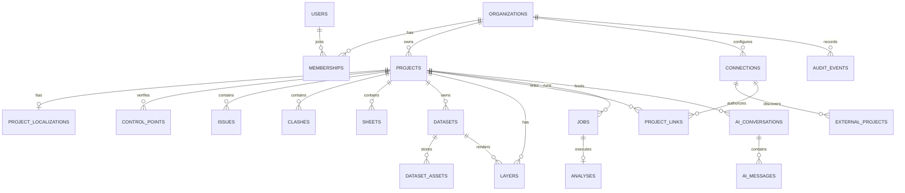

# Data Model

| | |
|---|---|
| **Status** | Proposed |
| **Database** | PostgreSQL 17 + PostGIS 3.5 + pgvector |
| **Related** | [ARCHITECTURE](ARCHITECTURE.md) · [API](API.md) · [GEOSPATIAL](GEOSPATIAL.md) |

---

## 1. Conventions

| Concern | Rule |
|---|---|
| IDs | UUIDv7, generated by the application, time-ordered |
| Tenancy | `org_id` on every tenant-owned table; enforced in the repository layer and tested with IDOR cases |
| Naming | `snake_case` in the database; `camelCase` in JSON |
| Timestamps | `timestamptz`, UTC; `created_at`, `updated_at` |
| Soft delete | `deleted_at` only where recovery matters (projects, datasets); hard delete for tokens |
| Geometry | EPSG:4326 storage; `geometry(..., 4326)` with Z where available |
| CRS metadata | Explicit columns, never inferred from a geometry alone |
| Provenance | `source`, `source_url`, `retrieved_at`, `raw_hash`, `licence`, `attribution` for external data |
| Enums | `text` + `CHECK` constraints for evolvability; no PostgreSQL enums in v1 |
| JSON | `jsonb` for provider payloads and flexible metadata; promoted columns for anything queried |
| Audit | Append-only; no updates or deletes through the application role |

### Schemas

- `core` — tenants, projects, connections, data, jobs, AI, audit.
- `gis` — optional materialised analysis geometries and helper views.
- `ext` — extension-owned objects (not managed by migrations).

---

## 2. Entity relationship overview



---

## 3. Core tables

### 3.1 Identity and tenancy

```sql
CREATE EXTENSION IF NOT EXISTS postgis;
CREATE EXTENSION IF NOT EXISTS pg_trgm;
CREATE EXTENSION IF NOT EXISTS vector;
CREATE EXTENSION IF NOT EXISTS citext;

CREATE SCHEMA IF NOT EXISTS core;
CREATE SCHEMA IF NOT EXISTS gis;

CREATE TABLE core.organizations (
  id          uuid PRIMARY KEY,
  name        text NOT NULL,
  slug        citext NOT NULL UNIQUE,
  created_at  timestamptz NOT NULL DEFAULT now(),
  updated_at  timestamptz NOT NULL DEFAULT now()
);

CREATE TABLE core.users (
  id            uuid PRIMARY KEY,
  email         citext NOT NULL UNIQUE,
  display_name  text NOT NULL,
  password_hash text,                 -- NULL when OIDC-only
  is_active     boolean NOT NULL DEFAULT true,
  created_at    timestamptz NOT NULL DEFAULT now(),
  updated_at    timestamptz NOT NULL DEFAULT now()
);

CREATE TABLE core.memberships (
  org_id     uuid NOT NULL REFERENCES core.organizations(id) ON DELETE CASCADE,
  user_id    uuid NOT NULL REFERENCES core.users(id) ON DELETE CASCADE,
  role       text NOT NULL CHECK (role IN ('owner','admin','member','viewer')),
  created_at timestamptz NOT NULL DEFAULT now(),
  PRIMARY KEY (org_id, user_id)
);
```

### 3.2 Projects and localization

```sql
CREATE TABLE core.projects (
  id            uuid PRIMARY KEY,
  org_id        uuid NOT NULL REFERENCES core.organizations(id) ON DELETE CASCADE,
  name          text NOT NULL,
  code          text,
  description   text,
  status        text NOT NULL DEFAULT 'active'
                CHECK (status IN ('active','archived')),
  address       text,
  country       char(2),
  timezone      text NOT NULL DEFAULT 'UTC',
  analysis_crs  text NOT NULL DEFAULT 'EPSG:3857',
  bbox          geometry(Polygon, 4326),
  created_by    uuid REFERENCES core.users(id),
  created_at    timestamptz NOT NULL DEFAULT now(),
  updated_at    timestamptz NOT NULL DEFAULT now(),
  deleted_at    timestamptz
);

CREATE INDEX projects_org_idx ON core.projects (org_id) WHERE deleted_at IS NULL;
CREATE INDEX projects_bbox_idx ON core.projects USING gist (bbox);

CREATE TABLE core.project_localizations (
  project_id      uuid PRIMARY KEY REFERENCES core.projects(id) ON DELETE CASCADE,
  method          text NOT NULL
                  CHECK (method IN ('api_metadata','control_points','map_pick','address_geocode','ifc_site')),
  source_crs      text NOT NULL,
  target_crs      text NOT NULL,
  transform       jsonb NOT NULL,      -- {type, tx, ty, rotationDeg, scale, matrix4x4}
  anchor          geometry(PointZ, 4326),
  rotation_deg    double precision,
  scale           double precision,
  accuracy_m      double precision CHECK (accuracy_m >= 0),
  confidence      text NOT NULL CHECK (confidence IN ('verified','calculated','indicative')),
  vertical_datum  text,
  notes           text,
  verified_by     uuid REFERENCES core.users(id),
  verified_at     timestamptz,
  created_at      timestamptz NOT NULL DEFAULT now(),
  updated_at      timestamptz NOT NULL DEFAULT now()
);

CREATE TABLE core.control_points (
  id          uuid PRIMARY KEY,
  project_id  uuid NOT NULL REFERENCES core.projects(id) ON DELETE CASCADE,
  label       text NOT NULL,
  model_x     double precision NOT NULL,
  model_y     double precision NOT NULL,
  model_z     double precision,
  target      geometry(PointZ, 4326) NOT NULL,
  residual_m  double precision,
  source      text,
  created_at  timestamptz NOT NULL DEFAULT now(),
  UNIQUE (project_id, label)
);
```

### 3.3 Connections and external projects

```sql
CREATE TABLE core.connections (
  id           uuid PRIMARY KEY,
  org_id       uuid NOT NULL REFERENCES core.organizations(id) ON DELETE CASCADE,
  provider     text NOT NULL CHECK (provider IN ('revizto','mock','ifc','speckle')),
  name         text NOT NULL,
  region       text,
  status       text NOT NULL DEFAULT 'pending'
               CHECK (status IN ('pending','connected','error','revoked')),
  config       jsonb NOT NULL DEFAULT '{}'::jsonb,  -- non-secret settings only
  scopes       text[] NOT NULL DEFAULT '{}',
  last_sync_at timestamptz,
  created_by   uuid REFERENCES core.users(id),
  created_at   timestamptz NOT NULL DEFAULT now(),
  updated_at   timestamptz NOT NULL DEFAULT now(),
  UNIQUE (org_id, provider, name)
);

CREATE TABLE core.connection_secrets (
  connection_id uuid PRIMARY KEY REFERENCES core.connections(id) ON DELETE CASCADE,
  ciphertext    bytea NOT NULL,
  nonce         bytea NOT NULL,
  key_version   integer NOT NULL,
  expires_at    timestamptz,
  updated_at    timestamptz NOT NULL DEFAULT now()
);

CREATE TABLE core.external_projects (
  id             uuid PRIMARY KEY,
  connection_id  uuid NOT NULL REFERENCES core.connections(id) ON DELETE CASCADE,
  remote_id      text NOT NULL,
  name           text NOT NULL,
  metadata       jsonb NOT NULL DEFAULT '{}'::jsonb,
  raw_hash       text,
  last_seen_at   timestamptz,
  created_at     timestamptz NOT NULL DEFAULT now(),
  UNIQUE (connection_id, remote_id)
);

CREATE TABLE core.project_links (
  id                  uuid PRIMARY KEY,
  project_id          uuid NOT NULL REFERENCES core.projects(id) ON DELETE CASCADE,
  connection_id       uuid NOT NULL REFERENCES core.connections(id) ON DELETE CASCADE,
  external_project_id uuid NOT NULL REFERENCES core.external_projects(id) ON DELETE CASCADE,
  sync_enabled        boolean NOT NULL DEFAULT true,
  sync_cursor         jsonb NOT NULL DEFAULT '{}'::jsonb,
  last_synced_at      timestamptz,
  created_at          timestamptz NOT NULL DEFAULT now(),
  UNIQUE (project_id, connection_id),
  UNIQUE (connection_id, external_project_id)
);
```

### 3.4 Synced BIM records

```sql
CREATE TABLE core.issues (
  id                uuid PRIMARY KEY,
  project_id        uuid NOT NULL REFERENCES core.projects(id) ON DELETE CASCADE,
  external_id       text NOT NULL,
  title             text NOT NULL,
  description       text,
  status            text NOT NULL DEFAULT 'open',
  priority          text NOT NULL DEFAULT 'normal'
                    CHECK (priority IN ('critical','high','normal','low')),
  discipline        text,
  assignee_name     text,
  due_date          date,
  location          geometry(PointZ, 4326),
  model_position    jsonb,
  sheet_external_id text,
  source_updated_at timestamptz,
  synced_at         timestamptz NOT NULL DEFAULT now(),
  raw               jsonb NOT NULL DEFAULT '{}'::jsonb,
  search_vector     tsvector GENERATED ALWAYS AS (
                      to_tsvector('simple', coalesce(title,'') || ' ' || coalesce(description,''))
                    ) STORED,
  UNIQUE (project_id, external_id)
);

CREATE INDEX issues_project_status_idx ON core.issues (project_id, status);
CREATE INDEX issues_project_priority_idx ON core.issues (project_id, priority);
CREATE INDEX issues_location_idx ON core.issues USING gist (location);
CREATE INDEX issues_search_idx ON core.issues USING gin (search_vector);

CREATE TABLE core.clashes (
  id             uuid PRIMARY KEY,
  project_id     uuid NOT NULL REFERENCES core.projects(id) ON DELETE CASCADE,
  external_id    text NOT NULL,
  title          text NOT NULL,
  status         text NOT NULL DEFAULT 'open',
  priority       text NOT NULL DEFAULT 'normal',
  location       geometry(PointZ, 4326),
  elements       jsonb NOT NULL DEFAULT '[]'::jsonb,
  source_updated_at timestamptz,
  synced_at      timestamptz NOT NULL DEFAULT now(),
  raw            jsonb NOT NULL DEFAULT '{}'::jsonb,
  UNIQUE (project_id, external_id)
);

CREATE INDEX clashes_location_idx ON core.clashes USING gist (location);

CREATE TABLE core.sheets (
  id             uuid PRIMARY KEY,
  project_id     uuid NOT NULL REFERENCES core.projects(id) ON DELETE CASCADE,
  external_id    text NOT NULL,
  number         text NOT NULL,
  title          text NOT NULL,
  discipline     text,
  thumbnail_key  text,
  metadata       jsonb NOT NULL DEFAULT '{}'::jsonb,
  source_updated_at timestamptz,
  synced_at      timestamptz NOT NULL DEFAULT now(),
  UNIQUE (project_id, external_id)
);
```

### 3.5 Datasets and layers

```sql
CREATE TABLE core.datasets (
  id            uuid PRIMARY KEY,
  project_id    uuid NOT NULL REFERENCES core.projects(id) ON DELETE CASCADE,
  name          text NOT NULL,
  kind          text NOT NULL
                CHECK (kind IN ('vector','raster','pointcloud','tiles3d','table')),
  format        text NOT NULL,
  source_kind   text NOT NULL
                CHECK (source_kind IN ('upload','url','connector','analysis')),
  crs           text,
  bbox          geometry(Polygon, 4326),
  metadata      jsonb NOT NULL DEFAULT '{}'::jsonb,
  licence       text,
  attribution   text,
  source_url    text,
  retrieved_at  timestamptz,
  created_by    uuid REFERENCES core.users(id),
  created_at    timestamptz NOT NULL DEFAULT now(),
  deleted_at    timestamptz
);

CREATE INDEX datasets_project_idx ON core.datasets (project_id) WHERE deleted_at IS NULL;
CREATE INDEX datasets_bbox_idx ON core.datasets USING gist (bbox);

CREATE TABLE core.dataset_assets (
  id               uuid PRIMARY KEY,
  dataset_id       uuid NOT NULL REFERENCES core.datasets(id) ON DELETE CASCADE,
  role             text NOT NULL CHECK (role IN ('original','derived','tile','thumbnail')),
  object_key       text NOT NULL,
  content_type     text NOT NULL,
  size_bytes       bigint NOT NULL CHECK (size_bytes >= 0),
  checksum_sha256  char(64) NOT NULL,
  min_zoom         integer,
  max_zoom         integer,
  created_at       timestamptz NOT NULL DEFAULT now(),
  UNIQUE (dataset_id, role, object_key)
);

CREATE TABLE core.layers (
  id            uuid PRIMARY KEY,
  project_id    uuid NOT NULL REFERENCES core.projects(id) ON DELETE CASCADE,
  dataset_id    uuid REFERENCES core.datasets(id) ON DELETE SET NULL,
  name          text NOT NULL,
  type          text NOT NULL
                CHECK (type IN ('geojson','mvt','raster','cog','xyz','pmtiles','3dtiles','pointcloud')),
  style         jsonb NOT NULL DEFAULT '{}'::jsonb,
  filter        jsonb NOT NULL DEFAULT '{}'::jsonb,
  visible       boolean NOT NULL DEFAULT true,
  opacity       double precision NOT NULL DEFAULT 1
                CHECK (opacity >= 0 AND opacity <= 1),
  z_index       integer NOT NULL DEFAULT 0,
  source_config jsonb NOT NULL DEFAULT '{}'::jsonb,
  created_by    uuid REFERENCES core.users(id),
  created_at    timestamptz NOT NULL DEFAULT now(),
  updated_at    timestamptz NOT NULL DEFAULT now()
);

CREATE INDEX layers_project_idx ON core.layers (project_id, z_index);
```

### 3.6 Jobs and analyses

```sql
CREATE TABLE core.jobs (
  id              uuid PRIMARY KEY,
  org_id          uuid NOT NULL REFERENCES core.organizations(id) ON DELETE CASCADE,
  project_id      uuid REFERENCES core.projects(id) ON DELETE CASCADE,
  type            text NOT NULL,
  status          text NOT NULL DEFAULT 'queued'
                  CHECK (status IN ('queued','running','succeeded','failed','cancelled')),
  priority        integer NOT NULL DEFAULT 0,
  payload         jsonb NOT NULL DEFAULT '{}'::jsonb,
  progress        integer NOT NULL DEFAULT 0 CHECK (progress BETWEEN 0 AND 100),
  attempts        integer NOT NULL DEFAULT 0,
  max_attempts    integer NOT NULL DEFAULT 3,
  run_at          timestamptz NOT NULL DEFAULT now(),
  locked_by       text,
  locked_at       timestamptz,
  lease_expires_at timestamptz,
  error           jsonb,
  idempotency_key text,
  created_by      uuid REFERENCES core.users(id),
  created_at      timestamptz NOT NULL DEFAULT now(),
  updated_at      timestamptz NOT NULL DEFAULT now(),
  UNIQUE (org_id, idempotency_key)
);

CREATE INDEX jobs_claim_idx ON core.jobs (status, run_at, priority DESC);
CREATE INDEX jobs_project_idx ON core.jobs (project_id, created_at DESC);

CREATE TABLE core.analyses (
  id                uuid PRIMARY KEY,
  project_id        uuid NOT NULL REFERENCES core.projects(id) ON DELETE CASCADE,
  job_id            uuid REFERENCES core.jobs(id) ON DELETE SET NULL,
  type              text NOT NULL,
  parameters        jsonb NOT NULL DEFAULT '{}'::jsonb,
  status            text NOT NULL DEFAULT 'queued'
                    CHECK (status IN ('queued','running','succeeded','failed','cancelled')),
  result_dataset_id uuid REFERENCES core.datasets(id) ON DELETE SET NULL,
  summary           jsonb,
  error             jsonb,
  created_by        uuid REFERENCES core.users(id),
  created_at        timestamptz NOT NULL DEFAULT now(),
  finished_at       timestamptz
);
```

Job claim query:

```sql
UPDATE core.jobs
SET status = 'running',
    locked_by = $1,
    locked_at = now(),
    lease_expires_at = now() + interval '5 minutes',
    attempts = attempts + 1,
    updated_at = now()
WHERE id = (
  SELECT id FROM core.jobs
  WHERE status = 'queued' AND run_at <= now()
  ORDER BY priority DESC, run_at
  FOR UPDATE SKIP LOCKED
  LIMIT 1
)
RETURNING *;
```

Workers extend the lease while running; an expired lease is reclaimable. `LISTEN/NOTIFY` wakes idle workers; a periodic poll is the fallback.

### 3.7 AI conversations

```sql
CREATE TABLE core.ai_conversations (
  id          uuid PRIMARY KEY,
  project_id  uuid NOT NULL REFERENCES core.projects(id) ON DELETE CASCADE,
  user_id     uuid NOT NULL REFERENCES core.users(id) ON DELETE CASCADE,
  title       text,
  created_at  timestamptz NOT NULL DEFAULT now(),
  updated_at  timestamptz NOT NULL DEFAULT now()
);

CREATE TABLE core.ai_messages (
  id              uuid PRIMARY KEY,
  conversation_id uuid NOT NULL REFERENCES core.ai_conversations(id) ON DELETE CASCADE,
  role            text NOT NULL CHECK (role IN ('system','user','assistant','tool')),
  content         text NOT NULL DEFAULT '',
  tool_calls      jsonb NOT NULL DEFAULT '[]'::jsonb,
  citations       jsonb NOT NULL DEFAULT '[]'::jsonb,
  model           text,
  tokens_in       integer,
  tokens_out      integer,
  created_at      timestamptz NOT NULL DEFAULT now()
);

CREATE INDEX ai_messages_conversation_idx
  ON core.ai_messages (conversation_id, created_at);
```

### 3.8 Audit and API keys

```sql
CREATE TABLE core.audit_events (
  id            bigint GENERATED ALWAYS AS IDENTITY PRIMARY KEY,
  org_id        uuid NOT NULL REFERENCES core.organizations(id) ON DELETE CASCADE,
  actor_id      uuid REFERENCES core.users(id) ON DELETE SET NULL,
  action        text NOT NULL,
  resource_type text NOT NULL,
  resource_id   text,
  metadata      jsonb NOT NULL DEFAULT '{}'::jsonb,
  ip            inet,
  user_agent    text,
  created_at    timestamptz NOT NULL DEFAULT now()
);

CREATE INDEX audit_org_time_idx ON core.audit_events (org_id, created_at DESC);

CREATE TABLE core.api_keys (
  id           uuid PRIMARY KEY,
  org_id       uuid NOT NULL REFERENCES core.organizations(id) ON DELETE CASCADE,
  name         text NOT NULL,
  key_prefix   text NOT NULL,
  key_hash     text NOT NULL,
  scopes       text[] NOT NULL DEFAULT '{}',
  last_used_at timestamptz,
  expires_at   timestamptz,
  created_by   uuid REFERENCES core.users(id),
  created_at   timestamptz NOT NULL DEFAULT now()
);
```

### 3.9 Saved views

```sql
CREATE TABLE core.saved_views (
  id         uuid PRIMARY KEY,
  project_id uuid NOT NULL REFERENCES core.projects(id) ON DELETE CASCADE,
  name       text NOT NULL,
  camera     jsonb NOT NULL,
  layer_state jsonb NOT NULL DEFAULT '{}'::jsonb,
  created_by uuid REFERENCES core.users(id),
  created_at timestamptz NOT NULL DEFAULT now()
);
```

---

## 4. Spatial rules

- **Storage CRS:** EPSG:4326 for all geometries. This keeps data portable and avoids a project-specific storage format.
- **Analysis CRS:** `projects.analysis_crs`, chosen at project creation from the site centroid, overridable by an admin. Switzerland defaults to EPSG:2056; other regions use the appropriate UTM zone or local grid.
- **Distance/area:** compute in the analysis CRS, never in degrees. Buffer in metres after `ST_Transform`.
- **3D:** use `PointZ` where elevation exists; record the vertical datum. Do not assume ellipsoidal height equals orthometric height.
- **Indexes:** GiST on every geometry column used for filtering; GIN on `jsonb` only when query patterns justify it.
- **Simplification:** MVT generation uses `ST_AsMVTGeom` with a tolerance by zoom; never simplify the stored geometry.
- **BBox:** maintained on write by the application or a trigger; used for viewport queries.
- **Invalid geometry:** reject on ingest with a clear error; offer `ST_MakeValid` as an explicit repair step, not silently.

---

## 5. Indexing and performance

| Query | Index |
|---|---|
| Projects in org | `projects (org_id) WHERE deleted_at IS NULL` |
| Issues by project/status | `issues (project_id, status)` |
| Issues in viewport | GiST on `issues.location` |
| Issue text search | GIN on `issues.search_vector` |
| Jobs to claim | `jobs (status, run_at, priority DESC)` |
| Layers in project | `layers (project_id, z_index)` |
| Audit by org/time | `audit_events (org_id, created_at DESC)` |
| Dataset bbox | GiST on `datasets.bbox` |

Rules:

- Avoid `SELECT *` in list endpoints; project only needed columns.
- Paginate by cursor, not offset, for large tables.
- Use `EXPLAIN (ANALYZE, BUFFERS)` for any query over 50 ms in development.
- Cache project summaries for 30 s; invalidate on sync completion.
- Tile queries are bounded by `ST_TileEnvelope` and a zoom-dependent feature limit.

---

## 6. Retention and deletion

| Data | Retention | Deletion |
|---|---|---|
| OAuth tokens | Until disconnect or expiry | Hard delete; revoke upstream |
| Synced issues/clashes/sheets | While linked; purge on disconnect after 30 days | Cascades from project/connection |
| Raw uploads | Until dataset deletion | Object delete + DB cascade |
| Derived assets | Until dataset deletion | Object delete + DB cascade |
| Jobs | 90 days | Scheduled cleanup |
| Audit events | 12 months (self-host configurable) | Append-only; retention policy |
| AI conversations | 90 days default | User delete; hard delete |
| Backups | 30 days | Encrypted; expiry |

Disconnect flow: revoke token → mark connection revoked → schedule purge → audit. The UI states exactly what will be removed.

---

## 7. Row-level security (future)

The MVP enforces tenancy in the repository layer with integration tests for cross-org access. Before hosted multi-tenancy, add PostgreSQL RLS as defence in depth:

```sql
ALTER TABLE core.projects ENABLE ROW LEVEL SECURITY;
CREATE POLICY project_org_isolation ON core.projects
  USING (org_id = current_setting('app.org_id')::uuid);
```

The API sets `app.org_id` per transaction. RLS is not a substitute for application checks; it is a second lock.

---

## 8. Seed fixture

The demo seed is deterministic:

- 1 organisation, 1 admin, 1 VDC lead, 8 project members.
- 1 project (`Hafenquartier Zürich`), 1 site polygon, 3 control points, 1 verified localization.
- 240 issues, 3 clashes, 12 sheets, 4 disciplines.
- 4 datasets: flood polygon (GeoJSON), hillshade (COG), utilities (GeoJSON), basemap (PMTiles).
- 5 layers with styles and attribution.
- 1 completed sync run, 1 analysis result, 3 saved views.
- 2 AI conversations with citations (optional; can be generated live).

Seed script requirements:

- Idempotent (`ON CONFLICT DO NOTHING` or a clean reset).
- No network calls.
- All names, emails, and coordinates fictional.
- A `demo_mode` flag that the UI reads to show the synthetic-data banner.

---

## 9. Migration policy

- Forward-only migrations, numbered and reviewed.
- Every migration has a rollback note; destructive changes require a backup and a two-step deploy.
- `sqlx migrate run` in CI against a fresh database and against a snapshot of the previous release.
- No migration may depend on application code; use SQL only.
- Large backfills run as jobs, not in the migration transaction.
- Schema changes to `audit_events` require security review.
