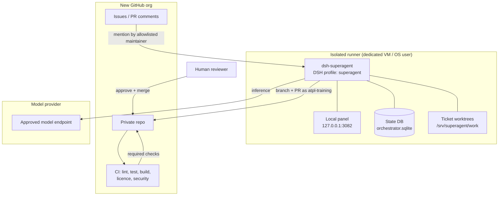

# Development Automation with Superagent

| | |
|---|---|
| **Purpose** | Use DeepSeek `dsh-superagent` early, without giving it the keys to the project |
| **Status** | Proposed — install in week 1 |
| **Owner** | Maintainer |
| **Related** | [GITHUB_ORG_SETUP](GITHUB_ORG_SETUP.md) · [SECURITY](SECURITY.md) · [LEGAL_COMPLIANCE](LEGAL_COMPLIANCE.md) |

---

## 1. What Superagent is

`dsh-superagent` is an **MIT-licensed research prototype** from DeepSeek. It is a proactive coding agent for one GitHub repository, packaged as a bundle for DeepSeek Harness. It watches GitHub (and optionally Feishu), turns an authorised request into a **Ticket** with an immutable **Mandate**, works in an isolated Worker session and directory, and delivers a result — usually a pull request — back to the original conversation. A local web panel shows work that needs a human ([repository](https://github.com/deepseek-ai/dsh-superagent-prototype), [deployment guide](https://github.com/deepseek-ai/dsh-superagent-prototype/blob/main/docs/006-deployment.md)).

Important properties:

- It needs a **dedicated GitHub user account**; a GitHub App cannot be the agent because it reads the account's notifications.
- It runs as a dedicated DeepSeek Harness profile, with `danger-full-access` as the operating-system user.
- It can read the operator's home directory and execute programs by path. **Isolation is not optional.**
- It is research code, not production software. Expect bugs and inconsistent engineering.
- Its design is explicitly conservative: allowed lists, Mandates, observe-first proactive work, and human merges.

We use it because it can take well-scoped work in parallel — tests, fixtures, documentation, small refactors — without consuming a human's full attention. We do **not** use it as an autonomous maintainer.

---

## 2. Why early

Integrating it after the architecture is frozen would make it a bolt-on. Integrating it in week 1:

- forces us to write `AGENTS.md`, ADRs, and acceptance criteria that humans also benefit from;
- establishes the review and disclosure habit before velocity pressure;
- lets us measure whether it actually saves time on this codebase;
- keeps it away from security-critical code while the project is small.

It is also a **product-relevant capability**: Terrassay's own AI assistant uses typed tools and human confirmation. Running Superagent gives the maintainer first-hand experience with agent permissions, mandates, and review that informs the product design.

---

## 3. Scope: what it may and may not do

| Lane | Examples | Rule |
|---|---|---|
| **Allowed** | Unit tests, fixture generators, docs, README updates, typo fixes, small refactors with existing tests, CI failure triage, dependency-free utility functions | Issue labelled `agent-ready`; human review |
| **Requires explicit approval** | New dependency, database migration, public API change, new service, performance-sensitive code, UI feature | Maintainer comments approval + design note |
| **Prohibited** | Auth/crypto, secrets, licence/legal files, `.github/workflows`, release signing, infrastructure credentials, Revizto OAuth, customer data, security policy, telemetry, billing | Branch protection + CODEOWNERS + prompt rules |

The agent must never receive:

- Revizto client secrets or tokens.
- Cloud provider keys, SSH keys, GPG keys, or personal access tokens.
- Customer data, real project models, or personal data.
- The maintainer's personal GitHub CLI session.
- Production or staging environment secrets.

---

## 4. Architecture



Trust boundaries:

- The runner is treated as **untrusted with respect to project secrets**, even though it is trusted to write code.
- GitHub is the system of record for review and merge.
- CI is the authority on whether the change is acceptable; the agent's local test run is advisory.
- The model provider is a data processor for source code prompts; use an approved configuration.

---

## 5. Install and configure (week 1)

> Run this on a **dedicated machine or VM**, not the maintainer's laptop. Use a dedicated OS user (for example `superagent`) with its own home directory, SSH keys, and `gh` config.

### 5.1 Prerequisites

- Node.js 22.19+ or 24+
- pnpm
- Git 2.32+
- Python 3.8+
- tmux
- GitHub CLI 2.48+
- DeepSeek Harness within the `engines.dsh` range of the Superagent `package.json`
- An approved model provider configured in DSH

### 5.2 Accounts

1. Use the human account `atpl-training`. No machine account or collaborator invite is needed; the account already owns the repo.
2. Create a fine-grained PAT scoped only to `terrassay/terrassay`, store it in macOS Keychain, and create the `gh-terrassay` wrapper ([GITHUB_ORG_SETUP](GITHUB_ORG_SETUP.md#6-superagent-token-and-macos-keychain)):
   ```sh
   security add-generic-password -a "atpl-training" -s "terrassay-github-pat" -w
   mkdir -p ~/.local/bin
   cat > ~/.local/bin/gh-terrassay <<'EOF'
   #!/bin/sh
   export GH_TOKEN="$(security find-generic-password -w -a "atpl-training" -s "terrassay-github-pat")"
   exec gh "$@"
   EOF
   chmod +x ~/.local/bin/gh-terrassay
   ~/.local/bin/gh-terrassay api user --jq .login
   ```
3. Do **not** sign the admin account into the runner.

### 5.3 Install

```sh
npm install -g @deepseek-ai/dsh@0.2.1-rc.3
git clone https://github.com/deepseek-ai/dsh-superagent-prototype.git dsh-superagent
cd dsh-superagent
pnpm install && pnpm build
dsh superagent --from-default-profile web --dump-config > /dev/null
dsh plugin --profile superagent add "link:$PWD"
```

Pin the DSH version. Do not run the profile-creation command on an existing profile; it replaces the profile and deletes `cordis.patch.yml`.

### 5.4 Machine configuration

Copy `examples/profile.cordis.patch.yml` to `~/.dsh/profiles/superagent/cordis.patch.yml` and set:

- `stateDir`: an absolute path on encrypted storage, for example `/srv/superagent/state`.
- Panel port: `3082`, bound to `127.0.0.1`.
- State and work directories backed up; no secrets in the state directory.
- Feishu disabled for now. One source of requests is enough.

### 5.5 Start

```sh
scripts/dsh-superagent start
scripts/dsh-superagent status
```

Open `http://127.0.0.1:3082` through an SSH tunnel if the runner is remote. Do not expose the panel to the internet.

### 5.6 Configure in the panel

**Sources → GitHub**

- Repository: `terrassay/terrassay`
- CLI: `/Users/<you>/.local/bin/gh-terrassay`
- Receive issues/comments; do not enable receive-all or CI-driven proactive work initially.

**Policy**

- Allowed users: the maintainer only (and trusted co-maintainers when added). No bots, no external contributors, no Feishu.
- Accept mode: **observe**. Review what it would have accepted before enabling anything proactive.
- Rules: start with one narrow rule, for example "documentation-only changes to `docs/` that do not touch legal/security files".

**Execution**

- Directory: `/srv/superagent/work`
- Max workers: 2
- Prepare command: a `git worktree` from a clean clone of `terrassay/terrassay`.
- Blocked commands: personal `gh`, `aws`, `gcloud`, `az`, `docker`, `ssh`, `scp`, `rsync` to external hosts, `kubectl`, `terraform`, `vault`, and any command that reads `~/.ssh` or cloud credential directories.

**Prompts**

- Commit author: `atpl-training` (AI-assisted; disclose in the PR).
- Auto-merge: **off**.
- Delivery requirements: small PR, tests, docs, `just check`, no new dependencies without approval, AI disclosure, no secrets, no customer data.

### 5.7 Verify

1. Create a test issue with a trivial docs fix, labelled `agent-ready`.
2. Comment `@atpl-training <request>` from an allowlisted maintainer. If GitHub does not deliver a self-mention, enable issue/comment observation in the Superagent source so it sees the comment without a notification.
3. Confirm a Ticket appears in the panel and a PR opens.
4. Confirm CI runs and the bot cannot merge or approve.
5. Confirm the PR states it is AI-assisted and names the agent account.
6. Review, request a change, and merge as a human.
7. Pause the executor and confirm no further work starts.

---

## 6. Work intake contract

Every agent task starts as an issue using `.github/ISSUE_TEMPLATE/agent-task.yml`:

```yaml
name: Agent task
description: A scoped task suitable for Superagent
labels: ["agent-ready"]
body:
  - type: textarea
    id: goal
    attributes:
      label: Goal
      description: One outcome, in one or two sentences.
  - type: textarea
    id: context
    attributes:
      label: Context
      description: Relevant files, ADRs, and prior art.
  - type: textarea
    id: acceptance
    attributes:
      label: Acceptance criteria
      description: Observable, testable conditions. Include commands.
  - type: textarea
    id: out_of_scope
    attributes:
      label: Out of scope
  - type: textarea
    id: verification
    attributes:
      label: Verification
      description: Tests to add/run; screenshots if UI.
```

Rules:

- One outcome per issue. If it needs a design decision, write an ADR first.
- Acceptance criteria must be testable by CI or a reviewer.
- No issue may ask the agent to "clean up" an unbounded area.
- The agent may open a PR only from a branch in the same repo, never from a fork.
- Human reviewers do not merge a PR they do not understand. "The agent wrote it" is not a review.

---

## 7. Prompt and repository rules (`AGENTS.md`)

`AGENTS.md` at the repo root is read by Superagent and by human contributors. It includes:

```markdown
# Agent instructions

You are working on Terrassay, an Apache-2.0 project. Read README.md, docs/BUILD_PLAN.md,
and the ADRs before changing code.

## Non-negotiables
- Do not add a dependency without a maintainer's explicit approval.
- Do not modify LICENSE, NOTICE, TRADEMARKS.md, SECURITY.md, or .github/workflows.
- Do not touch auth, crypto, OAuth, billing, or infrastructure credentials.
- Do not include secrets, tokens, personal data, customer data, or Revizto data.
- Do not copy code from other repositories or from memory of proprietary code.
- Keep PRs small: one concern, under ~400 changed lines where possible.
- Add or update tests for behaviour changes.
- Update docs when behaviour or configuration changes.
- Run `just check` before opening a PR.
- State clearly in the PR that the change is AI-assisted and which agent produced it.

## Architecture
- Rust API/worker: services/api, services/worker, crates/*
- Web shell: apps/web
- Map host: apps/map-host (GeoLibre; do not fork core)
- Contracts: packages/contracts
- Migrations: crates/db/migrations (requires approval)

## Definition of done
- CI green: lint, test, build, license, security.
- Tests cover the new behaviour.
- Docs updated.
- No new warnings in touched code.
- PR description includes risk, rollback, and verification.
```

The file is versioned and reviewed like code.

---

## 8. Review and merge controls

| Control | Setting |
|---|---|
| Branch protection | Require PR, 1 approval, CODEOWNERS, status checks, conversation resolution, linear history |
| Bot permissions | Full write to one repo (branches, PRs, issues, Actions read); no admin, no secrets, no org access |
| Auto-merge | Disabled; humans merge |
| Self-approval | Impossible: the bot cannot approve PRs |
| Workflow changes | CODEOWNERS + branch protection; bot blocked by prompt and permissions |
| Required checks | `lint`, `test`, `build`, `license`, `security` |
| PR size | Soft limit 400 lines; split larger work |
| Disclosure | PR template checkbox: "AI-assisted (agent: ___)" |
| Audit | GitHub audit log + Superagent state DB; retain 12 months |

If a PR touches a prohibited area, close it and redo the work with a human author. Do not "fix forward" a security-sensitive agent change.

---

## 9. Isolation and security controls

| Risk | Control |
|---|---|
| Full OS access | Dedicated VM/OS user; no personal home; full-disk encryption; minimal packages |
| Credential theft | Only bot `gh` credentials; no cloud/SSH/personal tokens; secrets manager inaccessible |
| Prompt injection via issues | Only allowlisted maintainers can trigger; external contributors cannot; treat issue text as untrusted |
| Malicious dependency | Dependency review; no new deps without approval; lockfiles; `cargo-deny`/`npm audit` |
| Data exfiltration | Egress allowlist (GitHub, package registries, model provider); no customer data; DNS/proxy logging |
| Licence contamination | Agent prompt forbids copying; PR scan; human review; `reuse`/SCA |
| Bad merge | Branch protection; required CI; human review; no auto-merge |
| Runaway cost | Model budget; max workers 2; pause switch; usage alerts |
| GitHub ToS | Disclosed bot account; no spam/scraping; no fake engagement |
| Supply chain | Pin DSH/Superagent versions; review upgrades; back up state DB |

### Egress allowlist (starting point)

- `github.com`, `api.github.com`, `objects.githubusercontent.com`
- `registry.npmjs.org`
- `static.crates.io`, `index.crates.io`
- `pypi.org`, `files.pythonhosted.org`
- The approved model endpoint only
- OS package mirrors used for the base image

Deny everything else. If the agent needs a new host, it must be approved and documented.

### Kill switch

1. Pause the executor in the panel.
2. Revoke the bot's GitHub token/session.
3. Revoke the fine-grained PAT and delete the Keychain item; remove the wrapper from the runner.
4. Preserve logs and the state DB for review.
5. Rotate any credential that may have been exposed.

Test the kill switch in week 1.

---

## 10. Metrics and review

Track per task:

- Time from issue to PR.
- PR size and files touched.
- CI pass rate on first attempt.
- Human review comments per PR.
- Rework rate (changes requested / merged).
- Escaped defects attributed to agent PRs.
- Token cost per merged PR.
- Percentage of agent PRs merged vs closed.

Review monthly. Stop or narrow the programme if:

- Rework rate is consistently higher than human-authored PRs.
- Any agent PR bypasses a control.
- Cost per merged PR exceeds the value.
- The team spends more time reviewing than writing.

Publish an internal monthly note: what worked, what failed, what changed. Do not publish agent-generated marketing content without review.

---

## 11. Cost

| Item | Monthly (approx.) |
|---|---:|
| Isolated VM (4 vCPU / 8 GB) | $20–$50 |
| Model usage (early, 2 workers) | $100–$400 |
| GitHub seat (bot) | $0–$4 |
| Backups/logging | $5–$15 |
| **Total** | **~$125–$470** |

Costs depend on model and task volume. Set a hard monthly budget with the provider; alert at 50/80/100%.

---

## 12. Failure modes and responses

| Failure | Response |
|---|---|
| Agent opens a huge PR | Close; split into scoped issues; tighten prompt and review |
| Agent changes a prohibited file | Revert; revoke write to that path via CODEOWNERS; review prompt |
| Agent installs an unexpected dependency | Reject; run licence/security review; add to blocked list |
| Agent leaks a secret in a PR | Revoke secret immediately; rotate; purge history; incident review |
| Agent gets stuck in a loop | Stop the Ticket; inspect logs; reduce scope; update prompt |
| Model provider outage | Pause; work continues without the agent |
| GitHub rate limit | Back off; reduce polling; do not create another account |
| DSH upgrade breaks the profile | Restore the state DB backup; pin the previous version |

---

## 13. What we will not do

- Give the agent org-owner, billing, or secrets access.
- Let it approve or merge its own PRs.
- Let it work on auth, crypto, legal, or release engineering.
- Feed it customer data, Revizto data, or personal data.
- Use it to generate licence headers or legal text.
- Use it to scrape or mass-produce issues/PRs.
- Hide that a change was AI-assisted.
- Treat its output as a substitute for human accountability.

---

## 14. Week-1 acceptance criteria

- [ ] Dedicated VM/OS user provisioned; full-disk encryption; no personal credentials.
- [ ] `gh-terrassay` wrapper reads the PAT from Keychain; `api user` prints `atpl-training`.
- [ ] Bot can push a branch and open a PR; cannot admin, approve, or merge.
- [ ] Superagent installed at a pinned version; panel bound to localhost.
- [ ] GitHub source configured for `terrassay/terrassay`; allowed list = `atpl-training`; accept mode `observe`.
- [ ] Executor prepare command works; blocked commands include personal/cloud CLIs.
- [ ] Auto-merge off; prompts include AI disclosure and prohibited areas.
- [ ] Test task produces a reviewed, merged docs PR.
- [ ] Kill switch tested and documented.
- [ ] Cost budget and alerts configured.
- [ ] `AGENTS.md`, issue template, PR template, and CODEOWNERS merged.

---

## 15. Legal note

Superagent is MIT-licensed and used only as a development tool. It is not distributed with Terrassay and does not process customer data. AI-assisted contributions are disclosed, reviewed by a human, and signed off under the DCO by a human with the right to contribute. The model provider's terms govern prompts and outputs; we do not send third-party confidential code. See [LEGAL_COMPLIANCE](LEGAL_COMPLIANCE.md#7-ai-and-development-automation).
