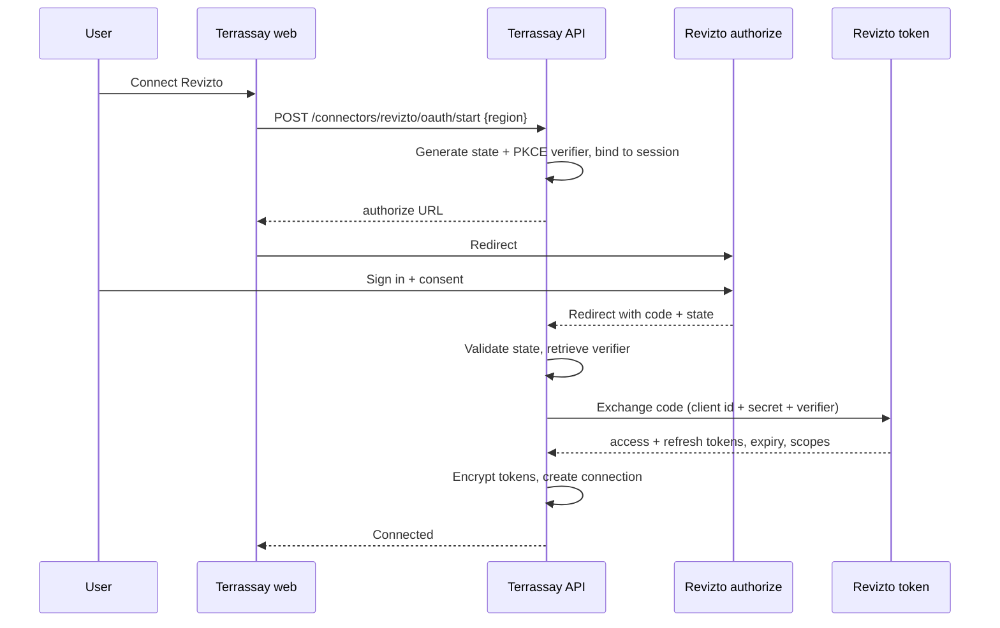

# Revizto Connector

| | |
|---|---|
| **Status** | Design + mock-first plan; no API access yet |
| **Scope** | Read-only project, issue, clash, sheet, and metadata sync |
| **Related** | [BUILD_PLAN](BUILD_PLAN.md) · [ARCHITECTURE](ARCHITECTURE.md) · [LEGAL_COMPLIANCE](LEGAL_COMPLIANCE.md) |

---

## 1. Why Revizto first

Revizto is widely used for BIM coordination and issue tracking on construction projects. It holds the project record that a site-intelligence workspace needs: projects, issues, clashes, sheets, members, and status. It is a better first integration than a raw IFC file because it provides **curated, current project data**, not just geometry.

It is also a deliberately **narrow** first integration. The connector proves the adapter architecture without coupling the product to Revizto.

---

## 2. What the API provides (confirmed)

| Capability | Status | Notes |
|---|---|---|
| OAuth 2.0 via Developer Portal | Confirmed | Custom app; client ID/secret; exact redirect URIs; HTTPS (localhost exempt) |
| Account-level API enablement | Confirmed | Owner/admin manages apps; standard users authorise |
| Per-user data access | Confirmed | Integration sees only what the user can see |
| Regional API hosts | Confirmed | `api.<region>.revizto.com`; `/v5/oauth2/authorize`, `/v5/oauth2/token` |
| Projects, issues, comments | Confirmed (documented) | API documentation at developer.revizto.com |
| Clashes, sheets, reports | Confirmed (documented) | Some operations may be plan/role dependent |
| Users, licences, members | Confirmed (documented) | Admin operations require admin rights |
| Object properties | Conditional | Requires *Extended API access* per project |
| Scene/model properties | Reported available | Exact fields unconfirmed |
| Model geometry import/export | **Not available** | MCP limitations explicitly exclude it |
| Screenshots / images | **Not available** via MCP | Do not depend on them |
| Webhooks / event subscriptions | **No documented REST/MCP webhooks** | Assume polling; confirm with vendor |
| Logs | **Not available** via MCP | Do not depend on them |

**Unconfirmed and must be validated with a real account:** exact REST paths, scopes, pagination model, rate limits, token lifetime, issue coordinate fields, clash coordinate fields, scene/model metadata schema, and whether a project-level georeference is exposed.

Sources: [Developer Portal](https://help.revizto.com/hc/en-us/articles/16924350271119-Revizto-developer-portal), [MCP server](https://help.revizto.com/hc/en-us/articles/16924308080271-Connecting-AI-tools-to-Revizto-MCP-server), [API documentation](https://help.revizto.com/hc/en-us/articles/9420673106063-Revizto-API-documentation), [API portal](https://developer.revizto.com/).

---

## 3. Regional hosts

Authorize and token URLs follow the account's region. The MCP documentation lists these regions:

| Region | API host |
|---|---|
| North America (USA) | `api.virginia.revizto.com` |
| Canada | `api.canada.revizto.com` |
| Europe (Ireland) | `api.ireland.revizto.com` |
| United Kingdom | `api.london.revizto.com` |
| UAE (hosted in Germany) | `api.frankfurt.revizto.com` |
| South America (Brazil) | `api.saopaulo.revizto.com` |
| Southeast Asia (Singapore) | `api.singapore.revizto.com` |
| ANZ (Australia) | `api.sydney.revizto.com` |
| Japan | `api.tokyo.revizto.com` |
| KSA (Premium) | `api.ksa.revizto.com` |
| Switzerland | `api.zurich.revizto.com` |

The user selects a region at connection time; the connector never guesses. A user with accounts in multiple regions creates multiple connections.

---

## 4. OAuth flow



Controls:

- `state` is single-use, 10-minute TTL, bound to the session and region.
- PKCE is used even for a confidential client.
- Redirect URIs are exact; no wildcards.
- The client secret is server-side only.
- Tokens are encrypted with AES-256-GCM (or XChaCha20-Poly1305) under a key-encryption key from the environment/KMS; per-connection data keys are wrapped.
- Refresh happens with a single-flight lock to avoid stampedes.
- Disconnect revokes the token upstream and deletes the ciphertext.

**Mock mode:** the web app exposes `/mock/revizto/authorize`, which shows a clearly labelled consent screen, lets the user pick a synthetic account/project, and returns a mock code. The API's `MockReviztoProvider` exchanges it for an opaque mock token. This exercises the real state machine without vendor credentials.

---

## 5. Connector interface

```rust
#[async_trait]
pub trait BimConnector: Send + Sync {
    fn provider(&self) -> Provider;
    async fn authorize_url(&self, state: &OAuthState) -> Result<AuthorizeUrl>;
    async fn exchange_code(&self, code: &str, verifier: &str) -> Result<TokenSet>;
    async fn refresh(&self, token: &TokenSet) -> Result<TokenSet>;
    async fn revoke(&self, token: &TokenSet) -> Result<()>;

    async fn list_projects(&self, token: &TokenSet) -> Result<Vec<RemoteProject>>;
    async fn get_project(&self, token: &TokenSet, id: &str) -> Result<RemoteProject>;
    async fn sync_issues(&self, token: &TokenSet, cursor: Option<Cursor>) -> Result<Page<RemoteIssue>>;
    async fn sync_clashes(&self, token: &TokenSet, cursor: Option<Cursor>) -> Result<Page<RemoteClash>>;
    async fn sync_sheets(&self, token: &TokenSet, cursor: Option<Cursor>) -> Result<Page<RemoteSheet>>;
    async fn model_metadata(&self, token: &TokenSet, id: &str) -> Result<ModelMetadata>;
}
```

Rules:

- The trait returns **canonical** types, not vendor JSON.
- Vendor-specific fields are preserved in `raw` for debugging and future promotion.
- Pagination is modelled as an opaque `Cursor`; the adapter decides how to encode page tokens or `updated_at`.
- Errors are classified: `Auth`, `RateLimited { retry_after }`, `NotFound`, `Forbidden`, `Transient`, `Permanent`, `Unsupported`.
- The mock and real adapters share the same contract tests.

---

## 6. Canonical mapping

| Revizto concept | Terrassay entity | Notes |
|---|---|---|
| Account / licence | `organizations` (external ref) | Not a tenant boundary; the org is Terrassay's |
| Project | `projects` + `external_projects` | Link, do not duplicate the remote project |
| Issue | `issues` | `external_id`, status, priority, assignee, due date, location |
| Comment | future `issue_comments` | Not in MVP; preserve in `raw` |
| Clash | `clashes` | Elements as JSONB; location if available |
| Sheet | `sheets` | Thumbnail only if API provides it; otherwise placeholder |
| Member / user | `assignee_name` denormalised | Do not create Terrassay users from Revizto members |
| Model / scene | `projects.metadata` + `bim_models` (future) | Treat as metadata until geometry exists |
| Object properties | `raw` / future `bim_elements` | Requires Extended API access |

Normalisation rules:

- Timestamps converted to UTC; original timezone retained in `raw`.
- Status/priority mapped through an explicit table; unknown values preserved and shown as-is.
- Names are not used as keys; `external_id` is the key.
- Geometry is optional. If absent, the issue has no location and appears in a list only.
- Every record stores `source_updated_at` and `synced_at`.

---

## 7. Sync algorithm

1. **Discover:** list remote projects; upsert `external_projects`; show a picker.
2. **Link:** create `project_links` with `sync_enabled`.
3. **Initial sync:** fetch issues, clashes, sheets page by page; upsert by `(project_id, external_id)`.
4. **Incremental sync:** use `updated_at`/cursor if supported; otherwise page and compare `source_updated_at`.
5. **Reconcile:** mark records not seen in a full sync as `missing` (do not delete automatically); show a count.
6. **Progress:** emit `job.progress` every page; record counts.
7. **Retry:** on 429/5xx, back off with jitter; honour `Retry-After`; resume from cursor.
8. **Complete:** update `last_synced_at`, invalidate caches, emit `sync.completed`.

Rate-limit policy:

- Default budget: 60 requests/minute per connection, configurable.
- Concurrency: 2 in-flight requests.
- Exponential backoff: 1s, 2s, 4s, 8s, max 60s; jitter ±20%.
- Circuit breaker after 5 consecutive failures; surface a connection error.
- No parallel syncs for the same connection; a second trigger returns 409.

Idempotency:

- Every upsert uses a unique `(project_id, external_id)` constraint.
- The sync job has an idempotency key derived from connection + cursor window.
- A crash resumes safely; no duplicate records.

Deletion:

- Remote deletions are soft-marked `missing` and shown in a reconciliation report.
- A user can confirm removal; this is audited.

---

## 8. The geometry and georeference gap

This is the most important product risk.

The MCP server does **not** expose model import/export; the REST API's geometry capabilities are unconfirmed. It may expose scene/model properties and issue coordinates, but we cannot assume a georeferenced model. Therefore:

- **Do not promise "your Revizto model on a map" in the demo.** Promise "your project data on a map."
- The project location is established through the **localization workflow**: API metadata if present, control points, map pick, or address.
- Issues/clashes are placed only if the API provides coordinates or a model position that can be transformed.
- If coordinates are model-space, store `model_position` and transform it through the project localization to WGS84.
- Full 3D geometry comes later from IFC/3D Tiles/Speckle, aligned with the same localization record.

This is honest, technically sound, and avoids building on an endpoint that may not exist.

---

## 9. Mock connector

The mock is not a throwaway. It is the reference implementation of the contract and the demo's reliability layer.

Fixtures:

```text
fixtures/revizto/
├── account.json
├── projects.json
├── project-hqz.json
├── issues.json          # 240 records, deterministic
├── clashes.json         # 3 records
├── sheets.json          # 12 records
├── members.json
└── oauth.json           # mock token metadata
```

Requirements:

- Deterministic IDs and timestamps.
- No real people, projects, or coordinates.
- Realistic pagination and error cases (401, 429, 500) behind a test flag.
- A `scenario` query param for demos: `happy`, `slow`, `rate_limited`, `empty`.
- Contract tests run against both mock and recorded real responses (when available).

Mock OAuth screen:

- Clearly labelled **"Revizto sandbox (mock) — no real data"**.
- Explains that it simulates the authorization flow.
- Offers a synthetic account and project.
- Never asks for real Revizto credentials.

---

## 10. Security and compliance

- Read-only scopes for the MVP. No writes to Revizto.
- Tokens encrypted at rest; never logged; never sent to the browser.
- Per-user authorization; no shared service account for multiple users.
- Connection status visible; disconnect revokes and purges.
- Audit every connect, sync, disconnect, and token refresh failure.
- No redistribution of project data; no cross-customer access.
- No scraping, no rate-limit circumvention, no reverse engineering.
- Comply with Revizto's API terms; confirm caching/retention/AI-processing rights.
- Use the Revizto name only descriptively; include a non-affiliation disclaimer.

See [LEGAL_COMPLIANCE](LEGAL_COMPLIANCE.md#5-revizto-specific-compliance).

---

## 11. Test plan

| Test | Type | Pass condition |
|---|---|---|
| OAuth state mismatch | Integration | Rejected, audited |
| PKCE verifier mismatch | Integration | Rejected |
| Token refresh race | Integration | One refresh, no stampede |
| Pagination | Contract | All pages consumed, no duplicates |
| 429 handling | Contract | Backoff, resume, no data loss |
| 5xx handling | Contract | Retry, then classified failure |
| Idempotent re-sync | Integration | Same row count, updated timestamps |
| Remote deletion | Integration | Marked missing, not silently deleted |
| Cross-org token use | Security | 404/403, audited |
| Token at rest | Security | Ciphertext only; no plaintext in logs |
| Mock vs real normalisation | Contract | Identical canonical output for fixtures |
| Rate-limit budget | Load | Stays under configured budget |

---

## 12. Access checklist

Send this to the Revizto account owner/admin:

- [ ] Is API access enabled for the account?
- [ ] Which region hosts the project?
- [ ] Can you create a custom OAuth app in the Developer Portal?
- [ ] What redirect URI should we register for local development and the demo?
- [ ] Which scopes are available for projects, issues, clashes, sheets, and members?
- [ ] What are the rate limits and token lifetimes?
- [ ] Does the API expose issue/clash coordinates or a model transform?
- [ ] What do scene/model properties contain?
- [ ] Is Extended API access needed for the fields we want? Can it be enabled on a test project?
- [ ] Can you provide a non-production project for validation, or should we use synthetic fixtures?
- [ ] What do the terms say about caching, derived analyses, and AI processing?
- [ ] Who is the technical contact for API changes and deprecations?

Until this is answered, the mock remains the default and the real adapter is feature-flagged.

---

## 13. Open questions

1. Exact REST base path and endpoint names (the public portal may require login).
2. OAuth scopes and whether read-only is separable from write.
3. Pagination style and maximum page size.
4. Rate limits per account/user/app.
5. Token lifetime and refresh rotation behaviour.
6. Coordinate fields on issues and clashes; units and CRS.
7. Scene/model metadata: base point, true north, units, georeference.
8. Whether sheet thumbnails are retrievable.
9. Whether object properties require a separate endpoint or are embedded.
10. Webhook roadmap (none today).
11. Partner programme requirements and co-marketing rules.
12. Data residency and subprocessors for AI features.

---

## 14. References

- Revizto Developer Portal — <https://help.revizto.com/hc/en-us/articles/16924350271119-Revizto-developer-portal>
- Revizto API documentation — <https://help.revizto.com/hc/en-us/articles/9420673106063-Revizto-API-documentation>
- Revizto API portal — <https://developer.revizto.com/>
- Revizto MCP server and limitations — <https://help.revizto.com/hc/en-us/articles/16924308080271-Connecting-AI-tools-to-Revizto-MCP-server>
- pyRevizto (GPL-3.0; not used in the build) — <https://pypi.org/project/pyrevizto/0.7/>
